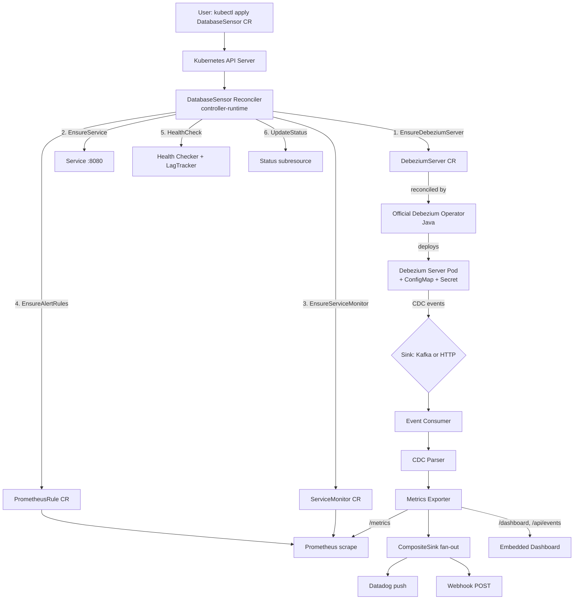
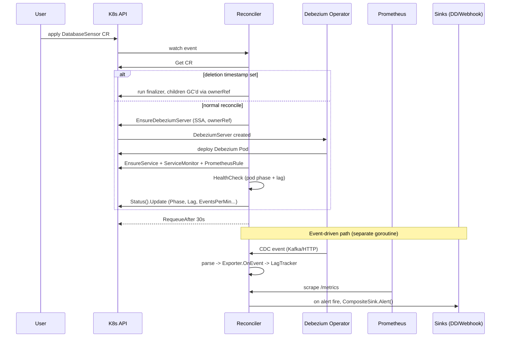

# Design Document: Lactiflluus (DatabaseSensor Operator)

## Overview

**Lactiflluus** is a Kubernetes Debezium-based operator that orchestrates database metric observability, multi-sink alerting, and DDL (schema-change) detection; it is implemented as the `DatabaseSensor` custom resource.

The DatabaseSensor Operator is a Kubernetes operator written in Go (Kubebuilder + controller-runtime) that turns a single declarative `DatabaseSensor` custom resource into a complete Change Data Capture (CDC) observability pipeline. It does **not** redeploy Debezium from scratch: it creates a `DebeziumServer` CR that the official Debezium Operator reconciles into a running Debezium Server. On top of that lifecycle, this operator adds the observability layer that the official operator lacks.

That observability layer does four things. It consumes the CDC event stream (Kafka or HTTP) and **derives per-operation, per-table metrics** (insert/update/delete rate, replication lag, schema changes). It **always exposes those metrics at `/metrics`** in Prometheus text format, regardless of which sink is configured. It **fans out alerts** to multiple backends through a `Sink` interface and a `CompositeSink` (Prometheus via `ServiceMonitor`/`PrometheusRule`, Datadog via push API, Webhook via JSON POST). And it **reports enriched status** (Phase, Lag, EventsPerMin, LastEvent, LastError) back on the CR so operators can read health with `kubectl get`.

The reconciler runs event-driven (on CR and owned-resource changes) and re-enqueues every 30 seconds via `RequeueAfter` to drive a periodic health check. CDC events themselves are event-driven, so the `RequeueAfter` loop exists primarily to detect the *absence* of events (growing lag, no-event timeouts). All child resources carry owner references for cascade deletion, status lives in a status subresource, and create-or-update uses Server-Side Apply consistently. This design preserves the architectural decisions recorded in `DESIGN.MD` (ADR-01 through ADR-10) and aligns with the steering files under `.kiro/steering/`.

---

## Architecture



The operator sits as an observability layer *above* the official Debezium Operator. The official operator owns Debezium's lifecycle (Deployment, ConfigMap, Secret, upgrades, restarts); this operator owns the `DebeziumServer` CR that drives it, plus the Service, ServiceMonitor, PrometheusRule, metric derivation, sink fan-out, and status.

### Reconcile Sequence



### Component Map (project layout)

The design maps 1:1 to the structure in the steering `structure.md`:

| Package | Responsibility |
|---|---|
| `api/v1` | `DatabaseSensorSpec` / `DatabaseSensorStatus` + kubebuilder markers |
| `internal/controller` | Reconciler loop, `SetupWithManager`, finalizer handling |
| `internal/deployer` | Builds/applies the `DebeziumServer` CR, maps DB type to connector class |
| `internal/metrics` | Prometheus registry + `/metrics`, `ServiceMonitor`, `PrometheusRule` |
| `internal/sink` | `Sink` interface, `CompositeSink`, `Registry`, Datadog + Webhook impls |
| `internal/health` | `Checker` (pod + lag -> phase) and `LagTracker` |
| `internal/events` | Kafka/HTTP consumer and Debezium JSON -> `CDCEvent` parser |
| `internal/dashboard` | Embedded HTML/Chart.js dashboard + `/api/events` ring buffer |
| `cmd` | Manager wiring, HTTP server, leader election |

---

## Components and Interfaces

### Component 1: Reconciler

**Purpose**: The single reconciliation loop for the `DatabaseSensor` Kind. Converges actual cluster state toward the desired state declared in the spec, then re-enqueues for the periodic health check.

**Interface**:
```go
type DatabaseSensorReconciler struct {
    client.Client
    Scheme   *runtime.Scheme
    Recorder record.EventRecorder
    Deployer *deployer.DebeziumDeployer
    Metrics  *metrics.Exporter
    Health   *health.Checker
    Sinks    *sink.Registry
}

// Reconcile converges one DatabaseSensor toward desired state.
func (r *DatabaseSensorReconciler) Reconcile(ctx context.Context, req ctrl.Request) (ctrl.Result, error)

// SetupWithManager wires watches: For(DatabaseSensor), Owns(DebeziumServer/Service/...).
func (r *DatabaseSensorReconciler) SetupWithManager(mgr ctrl.Manager) error
```

**Responsibilities**:
- Fetch the CR; treat `NotFound` as a successful no-op (object deleted).
- Handle deletion via owner references (cascade GC); no finalizer is required unless external cleanup is added later.
- Call `EnsureDebeziumServer`, `EnsureService`, `EnsureServiceMonitor`, `EnsureAlertRules` idempotently (Server-Side Apply).
- Run the health check and write status with conflict-safe retry.
- Return `RequeueAfter: 30s` on success.

### Component 2: DebeziumDeployer

**Purpose**: Translate a `DatabaseSensor` spec into a `DebeziumServer` CR for the official operator, mapping DB type to connector class and tables to filters.

**Interface**:
```go
type DebeziumDeployer struct {
    client.Client
    Scheme *runtime.Scheme
}

// EnsureDebeziumServer builds the DebeziumServer CR from the sensor spec,
// sets the owner reference, and applies it (create-or-update via SSA).
func (d *DebeziumDeployer) EnsureDebeziumServer(ctx context.Context, s *v1.DatabaseSensor) error

// connectorClassFor maps a supported DB type to its Debezium connector class.
func connectorClassFor(dbType string) (string, error)
```

**Responsibilities**:
- Map `spec.database.type` to the connector class (postgres/mysql/mongodb/...) and type-specific fields (`slot.name`, `database.server.id`).
- Map `spec.tables` to table include filters.
- Resolve `spec.database.passwordSecret`; if missing, surface a descriptive error so the reconciler can set `Failed`.
- Set the owner reference to the `DatabaseSensor` for cascade deletion.

### Component 3: Metrics Exporter

**Purpose**: Own the Prometheus registry, register derived metrics, update them from CDC events, and serve `/metrics` on port 8080.

**Interface**:
```go
type Exporter struct {
    eventsTotal   *prometheus.CounterVec // debezium_events_total{op,db,table}
    schemaChanges *prometheus.CounterVec // debezium_schema_changes_total{db,table}
    lagSeconds    *prometheus.GaugeVec   // debezium_lag_seconds{db,table}
    eventsPerMin  *prometheus.GaugeVec   // debezium_events_per_minute{db,table}
}

func NewExporter(reg prometheus.Registerer) *Exporter
func (e *Exporter) OnEvent(ev events.CDCEvent)
func (e *Exporter) Handler() http.Handler // promhttp.Handler()
```

**Responsibilities**:
- Register the four metric families once at startup.
- On each `CDCEvent`, increment the matching op counter (or schema-change counter) and update lag/rate gauges labeled by `db` host and `table`.
- Always expose `/metrics` regardless of configured sink (ADR-04).

### Component 4: Sink + CompositeSink

**Purpose**: Decouple the core from alert/metric backends. Adding a new backend is a new `Sink` implementation, not a change to the reconciler (ADR-03, open/closed).

**Interface**:
```go
type Sink interface {
    Push(ctx context.Context, m Metric) error
    Alert(ctx context.Context, a Alert) error
}

type CompositeSink struct{ sinks []Sink } // fan-out; one failure does not abort others
type Registry struct{ ... }               // builds the active CompositeSink from spec.sink

type WebhookSink struct{ url string; client *http.Client; timeout time.Duration }
type DatadogSink struct{ apiKey, appKey string; client *http.Client }
```

**Responsibilities**:
- `CompositeSink.Alert` / `Push` fan out to every active sink; collect errors without blocking the reconcile.
- `WebhookSink` POSTs a JSON alert body with timeout + bounded retry.
- `DatadogSink` pushes via the Datadog HTTP API, honoring `Retry-After` on 429.
- `Registry` activates sinks per `spec.sink.type` (`prometheus | datadog | webhook | all`).

### Component 5: Health Checker + LagTracker

**Purpose**: Decide the CR phase from Debezium pod state and replication lag.

**Interface**:
```go
type Checker struct {
    client.Client
    Lag *LagTracker
}

// Check returns the derived phase and current lag.
func (c *Checker) Check(ctx context.Context, s *v1.DatabaseSensor) (phase string, lag time.Duration, err error)

type LagTracker struct {
    mu     sync.Mutex
    lastTs time.Time
    gauge  prometheus.Gauge
}

func (t *LagTracker) OnEvent(tsMs int64) // lag = now() - event ts
func (t *LagTracker) GetLag() time.Duration
```

**Responsibilities**:
- Read the `DebeziumServer` status / pod phase.
- Apply thresholds: warning lag -> `Degraded`, critical lag or 30-min no-event -> `Failed`, 5-min no-event -> `Degraded`.
- Keep lag in memory (ADR-08: no durable controller state; the gauge and status are the outputs).

### Component 6: Event Consumer + Parser

**Purpose**: Receive the CDC stream and turn Debezium JSON into a typed `CDCEvent`.

**Interface**:
```go
type Consumer interface {
    Start(ctx context.Context, handler func(events.CDCEvent)) error
}

type KafkaConsumer struct{ ... } // segmentio/kafka-go
type HTTPConsumer struct{ ... }  // webhook listener for HTTP sink

// Parse extracts op, db host, table, and ts_ms from a Debezium envelope.
func Parse(raw []byte) (events.CDCEvent, error) // tidwall/gjson
```

**Responsibilities**:
- Kafka consumer reconnects with exponential backoff (max 60s) on disconnect.
- Parser classifies `op` (`c`/`u`/`d`), detects DDL/schema-change envelopes, extracts `ts_ms`.
- Each parsed event is handed to `Exporter.OnEvent` and `LagTracker.OnEvent`.

### Component 7: Embedded Dashboard

**Purpose**: A built-in HTML/Chart.js dashboard so users can inspect metrics without Grafana.

**Interface**:
```go
// RegisterRoutes mounts /dashboard and /api/events only when enabled.
func RegisterRoutes(mux *http.ServeMux, enabled bool, buf *RingBuffer)

type RingBuffer struct{ ... } // last N CDC events, size from spec.dashboard.retention
```

**Responsibilities**:
- Serve `/dashboard` (HTML) and `/api/events` (JSON of last N events) only when `spec.dashboard.enabled`.
- Keep events in an in-memory ring buffer sized by retention.

---

## Data Models

### DatabaseSensorSpec

```go
type DatabaseSensorSpec struct {
    Database  DatabaseConfig   `json:"database"`
    Tables    []string         `json:"tables"`
    Sink      SinkConfig       `json:"sink"`
    Dashboard *DashboardConfig `json:"dashboard,omitempty"`
}

type DatabaseConfig struct {
    // +kubebuilder:validation:Enum=postgresql;mysql;mariadb;mongodb;sqlserver;oracle;db2;cassandra
    Type           string `json:"type"`
    Host           string `json:"host"`
    Port           int32  `json:"port"`
    User           string `json:"user"`
    PasswordSecret string `json:"passwordSecret"`
}

type SinkConfig struct {
    // +kubebuilder:validation:Enum=prometheus;datadog;webhook;all
    Type       string          `json:"type"`
    Prometheus *PrometheusSink `json:"prometheus,omitempty"`
    Datadog    *DatadogSink    `json:"datadog,omitempty"`
    Webhook    *WebhookSink    `json:"webhook,omitempty"`
}

type PrometheusSink struct {
    Namespace      string      `json:"namespace,omitempty"`
    ServiceMonitor bool        `json:"serviceMonitor,omitempty"`
    AlertRules     []AlertRule `json:"alertRules,omitempty"`
}

type AlertRule struct {
    Name     string `json:"name"`
    Expr     string `json:"expr"`
    For      string `json:"for"`
    Severity string `json:"severity"`
}

type DatadogSink struct {
    Enabled      bool     `json:"enabled"`
    APIKeySecret string   `json:"apiKeySecret"`
    AppKeySecret string   `json:"appKeySecret"`
    Tags         []string `json:"tags,omitempty"`
}

type WebhookSink struct {
    Enabled   bool     `json:"enabled"`
    URL       string   `json:"url"`
    TriggerOn []string `json:"triggerOn,omitempty"`
}

type DashboardConfig struct {
    Enabled   bool   `json:"enabled"`
    Retention string `json:"retention,omitempty"` // e.g. "72h"
}
```

**Validation Rules**:
- `database.type` must be one of the supported enum values; anything else is rejected at admission (US-8.4).
- `database.host`, `database.user`, `database.passwordSecret` are required and non-empty.
- `tables` must contain at least one entry.
- `sink.type` must be one of `prometheus | datadog | webhook | all`.
- When `datadog.enabled`, `apiKeySecret` and `appKeySecret` are required.
- When `webhook.enabled`, `url` is required.

### DatabaseSensorStatus

```go
// +kubebuilder:subresource:status
type DatabaseSensorStatus struct {
    // +kubebuilder:validation:Enum=Pending;Running;Degraded;Failed
    Phase          string  `json:"phase,omitempty"`
    Lag            string  `json:"lag,omitempty"`          // human-readable duration
    EventsPerMin   float64 `json:"eventsPerMin,omitempty"`
    LastEvent      string  `json:"lastEvent,omitempty"`    // relative time
    LastError      string  `json:"lastError,omitempty"`    // empty if none
    DebeziumServer string  `json:"debeziumServer,omitempty"`
}
```

### CDCEvent (internal)

```go
type CDCEvent struct {
    Op     string // "c" insert, "u" update, "d" delete, "ddl" schema change
    DB     string // database host (metric label)
    Table  string // table name (metric label)
    TsMs   int64  // source timestamp in ms, for lag
}
```

**Phase values**: `Pending` (pod not yet running) -> `Running` (pod up, lag under threshold) -> `Degraded` (lag over warning or no events for 5m) -> `Failed` (lag over critical, no events for 30m, missing Secret, or pod CrashLoopBackOff).

### Derived Metrics

| Metric | Type | Labels | Source |
|---|---|---|---|
| `debezium_events_total` | CounterVec | `op`, `db`, `table` | increment per CDC op |
| `debezium_schema_changes_total` | CounterVec | `db`, `table` | increment per DDL event |
| `debezium_lag_seconds` | GaugeVec | `db`, `table` | `now() - ts_ms` |
| `debezium_events_per_minute` | GaugeVec | `db`, `table` | rate over a sliding window |

---

## Algorithmic Pseudocode

### Reconcile

```go
func (r *DatabaseSensorReconciler) Reconcile(ctx context.Context, req ctrl.Request) (ctrl.Result, error) {
    var s v1.DatabaseSensor
    if err := r.Get(ctx, req.NamespacedName, &s); err != nil {
        return ctrl.Result{}, client.IgnoreNotFound(err) // deleted -> no-op
    }

    // 1. Deletion is handled by owner-reference GC; nothing to do here unless a finalizer is added.

    // 2. Ensure the DebeziumServer CR (SSA + ownerRef). Missing Secret -> Failed.
    if err := r.Deployer.EnsureDebeziumServer(ctx, &s); err != nil {
        return r.fail(ctx, &s, err) // sets Phase=Failed, LastError, requeue 30s
    }

    // 3. Ensure Service + ServiceMonitor + PrometheusRule (idempotent).
    if err := r.ensureObservability(ctx, &s); err != nil {
        return ctrl.Result{}, err // transient API error -> backoff retry
    }

    // 4. Health check: pod phase + lag -> derived phase.
    phase, lag, err := r.Health.Check(ctx, &s)
    if err != nil {
        return ctrl.Result{}, err
    }

    // 5. Fan out alerts for any firing rule.
    r.maybeAlert(ctx, &s, phase, lag)

    // 6. Update status with conflict-safe retry.
    if err := r.updateStatus(ctx, &s, phase, lag); err != nil {
        return ctrl.Result{}, err
    }

    // 7. Periodic health-check loop.
    return ctrl.Result{RequeueAfter: 30 * time.Second}, nil
}
```

**Preconditions**: CRD installed; manager has RBAC for the Kinds it touches.
**Postconditions**: Child resources exist and match spec; status reflects observed health; the object is re-enqueued in 30s.
**Idempotence invariant**: running Reconcile N times yields the same child resources and the same status (the "second reconcile test" from `DESIGN.MD`).

### EnsureDebeziumServer

```go
func (d *DebeziumDeployer) EnsureDebeziumServer(ctx context.Context, s *v1.DatabaseSensor) error {
    class, err := connectorClassFor(s.Spec.Database.Type)
    if err != nil {
        return fmt.Errorf("unsupported database type %q: %w", s.Spec.Database.Type, err)
    }

    if err := d.secretExists(ctx, s.Namespace, s.Spec.Database.PasswordSecret); err != nil {
        return fmt.Errorf("passwordSecret %q not found: %w", s.Spec.Database.PasswordSecret, err)
    }

    ds := buildDebeziumServer(s, class)            // connection params + table filters
    if err := controllerutil.SetControllerReference(s, ds, d.Scheme); err != nil {
        return err
    }
    return d.Apply(ctx, ds)                         // Server-Side Apply (ADR-09)
}
```

**Preconditions**: `s.Spec.Database.Type` is a supported type; `passwordSecret` exists.
**Postconditions**: a `DebeziumServer` CR exists with the correct connector class, table filters, and an owner reference to `s`.

### LagTracker.OnEvent

```go
func (t *LagTracker) OnEvent(tsMs int64) {
    t.mu.Lock()
    defer t.mu.Unlock()
    eventTime := time.UnixMilli(tsMs)
    t.lastTs = eventTime
    t.gauge.Set(time.Since(eventTime).Seconds())
}
```

**Preconditions**: `tsMs` is a source timestamp in milliseconds.
**Postconditions**: `lastTs` updated; `debezium_lag_seconds` gauge set to `now() - eventTime`.
**Concurrency invariant**: all reads/writes of `lastTs` and the gauge are guarded by `mu`.

### Health phase decision

```go
func decidePhase(podRunning bool, lag time.Duration, sinceLastEvent time.Duration,
    warn, crit time.Duration) string {
    switch {
    case !podRunning:
        return "Pending"
    case lag >= crit || sinceLastEvent >= 30*time.Minute:
        return "Failed"
    case lag >= warn || sinceLastEvent >= 5*time.Minute:
        return "Degraded"
    default:
        return "Running"
    }
}
```

**Loop invariant** (consumer loop): after processing each event, the lag gauge reflects the most recent `ts_ms` seen so far, and the ring buffer holds at most N events.

---

## Key Functions with Formal Specifications

### connectorClassFor

```go
func connectorClassFor(dbType string) (string, error)
```
- **Preconditions**: `dbType` is a non-empty string.
- **Postconditions**: returns the Debezium connector class for a supported type (e.g. `io.debezium.connector.postgresql.PostgresConnector`), or a non-nil error listing supported types for anything else.
- **Purity**: no side effects; a pure mapping.

### Parse (CDC envelope)

```go
func Parse(raw []byte) (CDCEvent, error)
```
- **Preconditions**: `raw` is a Debezium JSON envelope.
- **Postconditions**: returns a `CDCEvent` with `Op`, `DB`, `Table`, `TsMs` populated; DDL envelopes map to `Op="ddl"`. Returns an error for malformed JSON without panicking.
- **No mutation**: `raw` is read-only.

### CompositeSink.Alert

```go
func (c *CompositeSink) Alert(ctx context.Context, a Alert) error
```
- **Preconditions**: `a` has a name, db host, value, threshold, timestamp, severity.
- **Postconditions**: every active sink receives the alert; a failure in one sink does not prevent delivery to others. Returns a joined error if any sink failed; the reconcile itself does not fail on sink errors (non-blocking).

---

## Example Usage

### Custom Resource

```yaml
apiVersion: sensor.io/v1
kind: DatabaseSensor
metadata:
  name: pg-orders
  namespace: prod
spec:
  database:
    type: postgresql
    host: postgres-svc.prod
    port: 5432
    user: debezium
    passwordSecret: db-creds
  tables: ["orders", "users", "payments"]
  sink:
    type: all
    prometheus:
      namespace: monitoring
      serviceMonitor: true
      alertRules:
        - name: HighLag
          expr: 'debezium_lag_seconds > 30'
          for: 5m
          severity: warning
        - name: NoEvents
          expr: 'rate(debezium_events_total[5m]) == 0'
          for: 15m
          severity: critical
    datadog:
      enabled: true
      apiKeySecret: dd-api-key
      appKeySecret: dd-app-key
      tags: ["env:prod", "db:postgres"]
    webhook:
      enabled: true
      url: https://hooks.slack.com/services/XXX
      triggerOn: [HighLag, NoEvents]
  dashboard:
    enabled: true
    retention: 72h
```

### Reading status

```bash
$ kubectl get databasesensor pg-orders -n prod
NAME        PHASE      LAG   EVENTS/MIN   LASTERROR
pg-orders   Degraded   42s   128.4
```

### Consumer wiring (Go)

```go
exp := metrics.NewExporter(prometheus.DefaultRegisterer)
consumer := events.NewKafkaConsumer(cfg)
go consumer.Start(ctx, func(ev events.CDCEvent) {
    exp.OnEvent(ev)          // updates counters + lag/rate gauges
    lagTracker.OnEvent(ev.TsMs)
    ringBuf.Add(ev)          // for /api/events
})
```

---

## Correctness Properties

### Property 1: DebeziumServer creation

For every `DatabaseSensor` with a valid database config and non-empty tables, a `DebeziumServer` CR exists in the same namespace with the correct connector class and table filters. (US-1.1, 8.1-8.3)

**Validates: Requirements 1.1, 8.1, 8.2, 8.3**

### Property 2: Cascade deletion

For every child resource created by the operator, it carries an owner reference to the `DatabaseSensor`; deleting the sensor removes all children. (US-1.2, 1.4)

**Validates: Requirements 1.2, 1.4**

### Property 3: Missing secret -> Failed

If `passwordSecret` references a non-existent Secret, `status.phase == "Failed"` and `status.lastError` is a descriptive message. (US-1.3)

**Validates: Requirements 1.3**

### Property 4: Event counting

For a sequence of N CDC events, `debezium_events_total` summed across labels equals N, partitioned correctly by `op`, `db`, and `table`. (US-2.1-2.4)

**Validates: Requirements 2.1, 2.2, 2.3, 2.4**

### Property 5: Lag monotonicity per event

After `OnEvent(tsMs)`, `debezium_lag_seconds` equals `now() - tsMs` for that `db`/`table`. (US-2.5)

**Validates: Requirements 2.5**

### Property 6: Metrics always exposed

`/metrics` returns Prometheus-format output regardless of `sink.type`. (US-3.1, ADR-04)

**Validates: Requirements 3.1**

### Property 7: Phase determinism

`decidePhase` is a pure function of (podRunning, lag, sinceLastEvent, thresholds); identical inputs always yield identical phases. (US-5.1-5.4)

**Validates: Requirements 5.1, 5.2, 5.3, 5.4**

### Property 8: Idempotent reconcile

Running Reconcile repeatedly on an unchanged spec does not duplicate resources or churn status (second-reconcile test). (NFR-6)

**Validates: Requirements 7.1**

### Property 9: Validation rejects unsupported DB

A CR with an unsupported `database.type` is rejected at admission by the enum marker. (US-8.4)

**Validates: Requirements 8.4**

### Property 10: Sink fan-out isolation

A failure in one sink does not prevent delivery to the other active sinks and does not fail the reconcile. (US-4.6, 4.4)

**Validates: Requirements 4.4, 4.6**

---

## Error Handling

| Situation | Reconcile return | Status |
|---|---|---|
| CR deleted (NotFound on Get) | `ctrl.Result{}, nil` | — |
| Invalid spec | `ctrl.Result{}, nil` | `Failed` + message |
| Secret not found | `ctrl.Result{RequeueAfter: 30s}, nil` | `Failed` + "Secret not found" |
| DebeziumServer CRD not installed | `ctrl.Result{}, nil` | `Failed` + "CRD not found" |
| API server timeout / 503 | `ctrl.Result{}, err` | unchanged (controller-runtime backoff) |
| Conflict on status update | internal `retry.RetryOnConflict` | — |
| Debezium pod CrashLoopBackOff | `ctrl.Result{RequeueAfter: 30s}, nil` | `Failed` + pod termination message |
| No events for 5 min | `ctrl.Result{RequeueAfter: 30s}, nil` | `Degraded` |
| No events for 30 min | `ctrl.Result{RequeueAfter: 30s}, nil` | `Failed` + "No CDC events received" |
| Webhook POST fails | `ctrl.Result{}, nil` (log + continue) | partial `LastError`, non-blocking |
| Datadog returns 429 | `ctrl.Result{RequeueAfter: RetryAfter}, nil` | unchanged |
| Kafka consumer disconnects | handled in consumer goroutine | reconnect with exp. backoff (max 60s) |
| All healthy | `ctrl.Result{RequeueAfter: 30s}, nil` | `Running` |

**Principles**: transient API errors return an error so controller-runtime applies exponential backoff; terminal spec problems (bad type, missing secret) set `Failed` and requeue slowly rather than hot-looping; sink delivery is always non-blocking so observability failures never stall reconciliation.

---

## Testing Strategy

The test pyramid from `DESIGN.MD` applies: most tests are envtest; unit tests cover pure logic; kind covers what envtest cannot (RBAC, networking, image pull, leader election).

### Unit Testing (testify)
- `LagTracker`: lag computation across event sequences, concurrency safety.
- CDC `Parse`: insert/update/delete/schema-change envelopes, malformed input.
- `WebhookSink`: POST body shape and retry via `httptest.Server`.
- `CompositeSink`: fan-out continues after one sink fails.
- `decidePhase`: full truth table of (podRunning, lag, sinceLastEvent).
- `connectorClassFor`: every supported type + the rejection path.

### Property-Based Testing
- **Library**: `gopter` (Go). 
- **P4/P5**: generate random event sequences; assert counter totals and per-event lag.
- **P7**: generate random (lag, sinceLastEvent) tuples; assert `decidePhase` matches the specification table.

### Integration Testing (envtest)
- Apply CR -> `DebeziumServer` appears with correct spec and owner reference.
- Delete CR -> `DebeziumServer` is garbage collected.
- Missing Secret -> status becomes `Failed`.
- Status transitions `Pending -> Running -> Degraded`.
- Second-reconcile idempotence (P8).

### E2E (kind)
- Full flow: apply CR -> Debezium deploys -> events flow -> `/metrics` reflects counts -> alert fires -> webhook received. Validates real RBAC and networking.

---

## Performance Considerations

- **Throughput (NFR-1)**: the event consumer must sustain ≥1000 events/sec per CR without dropping. The hot path (parse -> counter increment -> gauge set) is lock-light; `LagTracker` uses a single mutex over tiny critical sections, and Prometheus `CounterVec`/`GaugeVec` are concurrency-safe.
- **Reconcile latency (NFR-2)**: reconcile should complete in <5s under normal conditions; it performs a bounded set of SSA applies and one status update, all idempotent.
- **Backpressure**: the Kafka consumer processes in a dedicated goroutine so reconcile latency is independent of event rate.

## Security Considerations

- **Secrets (NFR-4)**: DB credentials and Datadog keys are read from Kubernetes Secrets at reconcile/push time, never hardcoded or logged by value. Secret contents are referenced by name only.
- **Least-privilege RBAC (NFR-5)**: the operator's ClusterRole grants only what it uses — `sensor.io` CRs, `debezium.io` CRs, apps/deployments (read), core services/configmaps/secrets, and `monitoring.coreos.com` ServiceMonitors/PrometheusRules.
- **HA + leader election (NFR-3)**: controller-runtime leader election ensures a single active reconciler across replicas; no durable state lives in the process (ADR-08).
- **Untrusted inputs**: CDC payloads and webhook targets are treated as data; the parser never evaluates payload content, and webhook URLs come only from the trusted CR spec.

## Dependencies

**External (installed separately)**:
- Official Debezium Operator (Apache 2.0, Java) — manages Debezium Server lifecycle.
- Prometheus Operator — provides `ServiceMonitor` and `PrometheusRule` CRDs.
- Kafka / Redpanda (optional) — only when the Debezium sink is Kafka; HTTP sink needs none.

**Go libraries** (per steering `tech.md`):
- `sigs.k8s.io/controller-runtime`, `k8s.io/client-go`
- `github.com/debezium/debezium-operator/api/v1` (DebeziumServer types)
- `github.com/prometheus/client_golang`, `github.com/prometheus/common`
- `github.com/tidwall/gjson` (CDC parsing)
- `github.com/segmentio/kafka-go` (Kafka consumer)
- `github.com/DataDog/datadog-api-client-go` (Datadog push)
- Testing: `envtest`, `testify`, `ginkgo`/`gomega`, `gopter` (property tests)

---

## Open Questions / Future Iterations

These are flagged as not-yet-settled in `DESIGN.MD` and are good candidates to refine during requirements and tasks:

1. **Active DDL detection for PostgreSQL** — logical decoding does not emit DDL. Options: periodic `information_schema` diffing, DDL event triggers, or schema snapshot comparison. This is the "killer feature" (schema_change alerts) and needs its own design pass.
2. **Finalizer vs. pure owner-reference GC** — current design relies on GC; a finalizer would be needed only if external (non-K8s) cleanup is added (e.g. deregistering from Datadog).
3. **events_per_minute window** — exact sliding-window algorithm and reset semantics on restart.
4. **Dashboard scope** — Option A (embedded HTML) now; Grafana auto-provisioning (ConfigMap) is a possible later addition.
