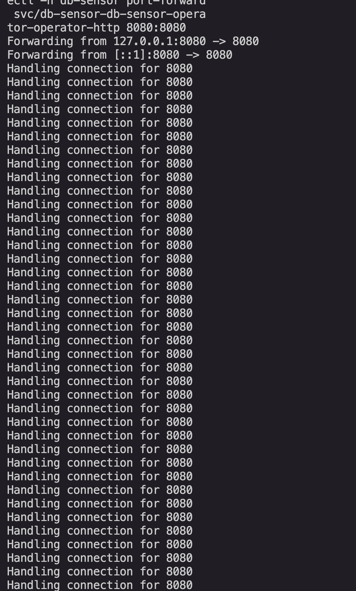
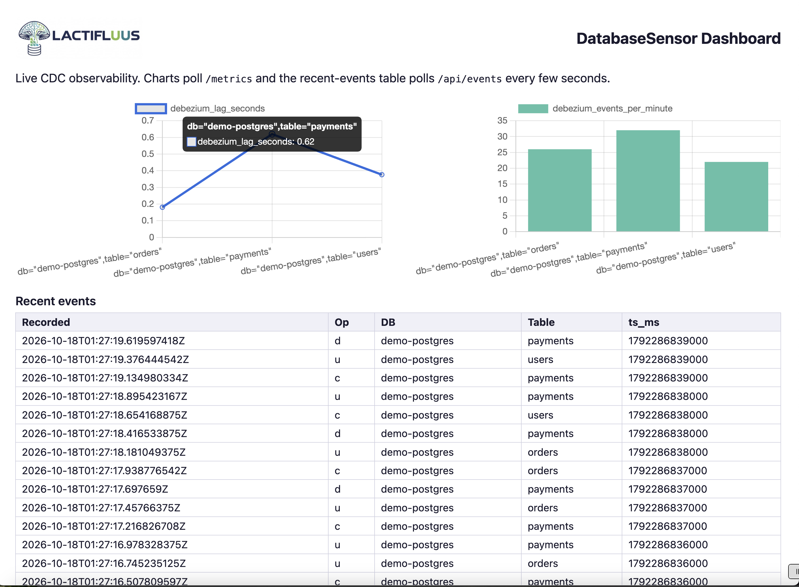
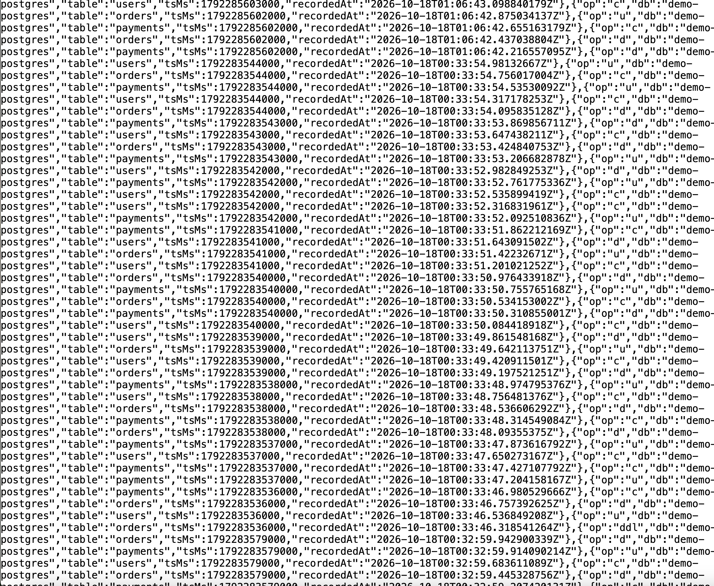

# Lactifluus — Demo Walkthrough

A documented, end-to-end run of the **synthetic-event demo**: the DatabaseSensor
operator driving its full observability pipeline (derived metrics, lag, events/min,
schema-change detection, live dashboard, enriched status, alert rules) on a local
`kind` cluster — with **no real database, Debezium Server, Kafka, or Datadog**.

The scripts live in [`demo/`](demo/); this document is the narrated walkthrough
with the actual output captured from a real run. For the quick-reference runbook,
see [`demo/README.md`](demo/README.md).

> **Why synthetic?** The operator's job is to consume and interpret CDC events,
> and events are just JSON. We drive the operator's HTTP ingestion endpoint
> (`POST /cdc` on `:8080`) with synthetic Debezium envelopes, so the whole
> pipeline lights up reliably with nothing to flake on stage. A real-database
> demo (Postgres + the official Debezium Operator) is a planned follow-up.

## Prerequisites

- Docker (running)
- `kind`, `kubectl`, `helm` on PATH — `brew install kind kubectl helm`

Verified tool versions from the reference run: kind v0.27.0, kubectl v1.32.3,
helm v3.14.2, kind node image Kubernetes v1.32.2.

## 1. One-command setup

```bash
./demo/setup.sh
```

This:
1. Creates the `kind-db-sensor-demo` cluster.
2. Installs the **ServiceMonitor + PrometheusRule** CRDs and the **minimal
   DebeziumServer CRD**.
3. Builds `db-sensor-operator:demo` and loads it into kind.
4. `helm install`s the operator into the `db-sensor` namespace with the `:8080`
   HTTP server enabled.
5. Creates the dummy `demo-db-creds` Secret the sample CR references.

> **Important — the DebeziumServer CRD.** The operator sets up an `.Owns()` watch
> on `DebeziumServer` at startup. If that CRD is absent, the watch fails to start
> and reconcile stalls with blank status:
>
> ```
> ERROR controller-runtime.source.Kind  if kind is a CRD, it should be installed
> before calling Start  {"kind": "DebeziumServer.debezium.io",
> "error": "no matches for kind \"DebeziumServer\" in version \"debezium.io/v1alpha1\""}
> ```
>
> In production this CRD is provided by the official Debezium Operator. The
> synthetic demo doesn't run real Debezium, so `setup.sh` installs only the
> minimal CRD (the same one the envtest suite uses) so the operator can create
> the child object. This was found and fixed during the first live run.

Verify the operator is up:

```bash
$ kubectl get pods -n db-sensor -l control-plane=controller-manager
NAME                                                              READY   STATUS    RESTARTS   AGE
db-sensor-db-sensor-operator-controller-manager-67ddfb8bdbtmbdb   1/1     Running   0          94s
```

## 2. Apply the sensor — one declarative resource

```bash
kubectl apply -f demo/sample-databasesensor.yaml
```

Within a reconcile cycle the operator creates **all four children**, each owned
by the DatabaseSensor:

```bash
$ kubectl -n db-sensor get debeziumservers,servicemonitors,prometheusrules,svc
NAME                                     AGE
debeziumserver.debezium.io/demo-orders   114s

NAME                                                       AGE
servicemonitor.monitoring.coreos.com/demo-orders-metrics   114s

NAME                                                                AGE
prometheusrule.monitoring.coreos.com/db-sensor-demo-orders-alerts   114s

NAME                                      TYPE        PORT(S)    AGE
service/demo-orders-metrics               ClusterIP   8080/TCP   114s
```

Owner reference confirms cascade deletion:

```bash
$ kubectl -n db-sensor get debeziumserver demo-orders \
    -o jsonpath='{.metadata.ownerReferences[0].kind}/{.metadata.ownerReferences[0].name}'
DatabaseSensor/demo-orders
```

The generated PrometheusRule carries the alert rules from the CR spec:

```bash
$ kubectl -n db-sensor get prometheusrule db-sensor-demo-orders-alerts \
    -o jsonpath='{range .spec.groups[*].rules[*]}{.alert}{"  expr="}{.expr}{"  for="}{.for}{"  sev="}{.labels.severity}{"\n"}{end}'
HighLag   expr=debezium_lag_seconds > 30            for=1m  sev=warning
NoEvents  expr=rate(debezium_events_total[5m]) == 0 for=2m  sev=critical
```

## 3. Port-forward the operator HTTP server

```bash
kubectl -n db-sensor port-forward svc/db-sensor-db-sensor-operator-operator-http 8080:8080
```

Once events start flowing you'll see the forwarder handling the `POST /cdc`
traffic:

<p align="center">
  
</p>

Open the dashboard: <http://localhost:8080/dashboard>

<p align="center">
  
</p>

## 4. Feed synthetic events — the pipeline lights up

```bash
./demo/generate-events.sh --burst 60      # 60 c/u/d events, then exit
./demo/generate-events.sh --ddl           # one schema-change (DDL) event
```

Each event returns `HTTP 204` (parsed and accepted). The derived metrics appear
on `/metrics`:

```bash
$ curl -s http://localhost:8080/metrics | grep '^debezium_'
debezium_events_per_minute{db="demo-postgres",table="orders"} 20
debezium_events_per_minute{db="demo-postgres",table="payments"} 17
debezium_events_per_minute{db="demo-postgres",table="users"} 23
debezium_events_total{db="demo-postgres",op="c",table="orders"} 6
debezium_events_total{db="demo-postgres",op="d",table="payments"} 9
debezium_events_total{db="demo-postgres",op="u",table="users"} 9
...
debezium_lag_seconds{db="demo-postgres",table="orders"} 0.94
debezium_schema_changes_total{db="demo-postgres",table="orders"} 1
```

- `debezium_events_total` is labeled by op (`c`/`u`/`d`) and table (US-2.1–2.3).
- `debezium_schema_changes_total` increments on the DDL event (US-2.4).
- `debezium_lag_seconds` is sub-second (events had fresh timestamps) (US-2.5).
- `debezium_events_per_minute` is the rolling rate per table (US-2.6).

Recent events via the ring-buffer API:

```bash
$ curl -s http://localhost:8080/api/events | jq '.[0]'
{
  "op": "ddl",
  "db": "demo-postgres",
  "table": "orders",
  "tsMs": 1792283579000,
  "recordedAt": "2026-10-18T00:32:59.942900339Z"
}
```

The raw `/api/events` response is the recent-events ring buffer, newest first —
each entry carries `op` (c/u/d/ddl), `db`, `table`, `tsMs`, and `recordedAt`:

<p align="center">
  
</p>

## 5. Show degradation — high lag

Emit stale events (timestamps 90s in the past) so lag crosses the 30s warning
threshold:

```bash
$ ./demo/generate-events.sh --burst 40 --lag 90
$ curl -s http://localhost:8080/metrics | grep debezium_lag_seconds
debezium_lag_seconds{db="demo-postgres",table="orders"}   90.76
debezium_lag_seconds{db="demo-postgres",table="payments"} 90.54
debezium_lag_seconds{db="demo-postgres",table="users"}    90.98
```

With Prometheus scraping, the `HighLag` rule (`debezium_lag_seconds > 30 for 1m`)
fires here. To show the **no-events** path instead, simply stop generating and
watch lag climb — the `NoEvents` rule (`rate(...) == 0 for 2m`) is its
counterpart.

## 6. A note on CR status in the synthetic demo

```bash
$ kubectl -n db-sensor get databasesensor demo-orders -o wide
NAME          PHASE     READY     LAG            DB TYPE      LAST ERROR
demo-orders   Pending   Unknown   2m51s          postgresql   DebeziumServer pod is not running yet
```

The CR-level **Phase stays `Pending`** with "DebeziumServer pod is not running
yet" — and this is **correct**. The health checker gates Phase on a real Debezium
pod being `Running`, and the synthetic demo deploys no such pod. The CR status
reflects "is the upstream healthy," while `/metrics` and `/dashboard` reflect
"what events are flowing" — both are honest. In a real-database demo the Debezium
pod would be `Running` and Phase would progress to `Running` / `Degraded` /
`Failed` per the thresholds.

## 7. Delete — everything cleans up

```bash
kubectl delete -f demo/sample-databasesensor.yaml
kubectl -n db-sensor get debeziumservers,servicemonitors,prometheusrules
```

Children are garbage-collected via owner references (same-namespace objects).

## Teardown

```bash
./demo/teardown.sh              # remove CR + release, keep the cluster
./demo/teardown.sh --cluster    # also delete the kind cluster
```

## What this demo proves

- One `DatabaseSensor` CR → the operator orchestrates DebeziumServer,
  ServiceMonitor, PrometheusRule, and a metrics Service, all owner-referenced.
- CDC events (synthetic, via `/cdc`) → derived Prometheus metrics by op/table,
  rolling events/min, lag, and schema-change counts.
- A live embedded dashboard and a recent-events JSON API.
- Alert rules rendered into a PrometheusRule; lag-threshold behavior demonstrable.
- Clean cascade deletion.

All of it on a laptop with Docker + kind, no external services.

## Known caveats (documented, not hidden)

- **Status Phase is `Pending`** in the synthetic demo (no real Debezium pod) — by
  design; see §6.
- **No real Prometheus server** is deployed — only its CRDs, so the operator can
  create ServiceMonitor/PrometheusRule. The demo reads `/metrics` directly; add
  `kube-prometheus-stack` to show real scraping + Alertmanager.
- **kindnet does not enforce NetworkPolicy** — the chart's NetworkPolicy is off by
  default anyway (see the main [README](README.md) NetworkPolicy & CNI section).
- The real-database demo (Postgres + official Debezium Operator) is a planned
  follow-up, intentionally not part of this synthetic kit.
