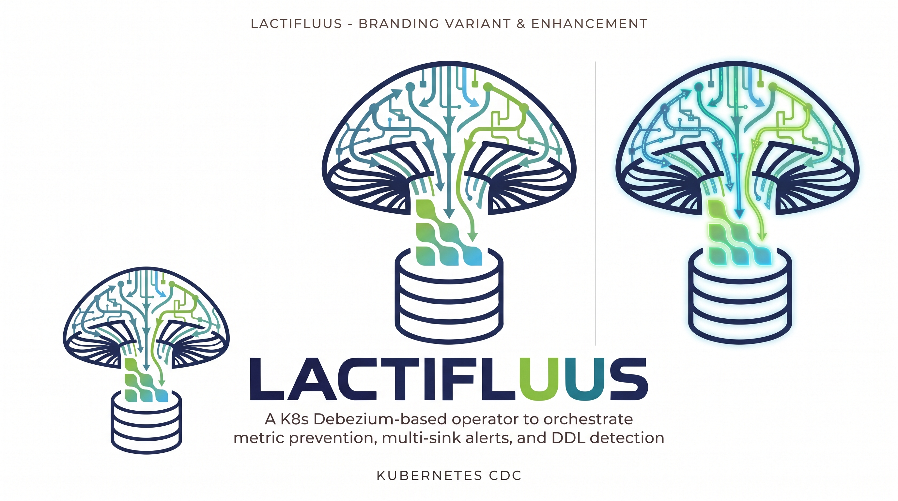
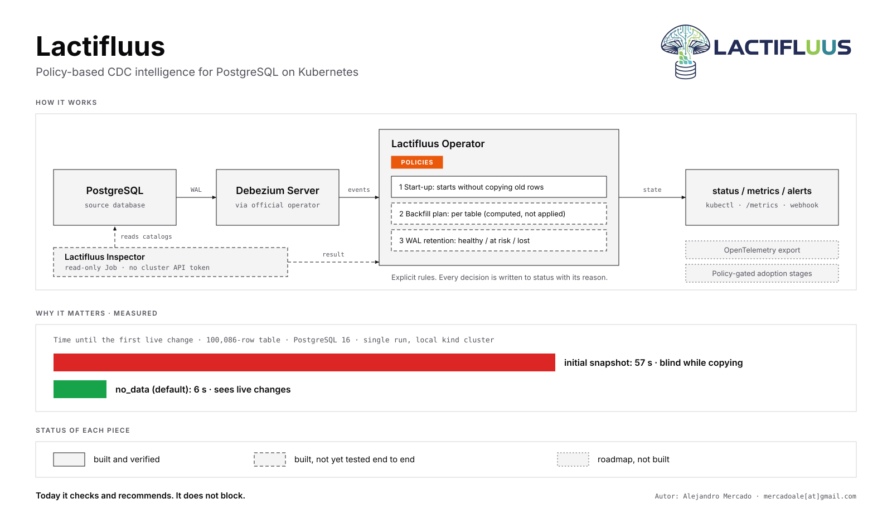
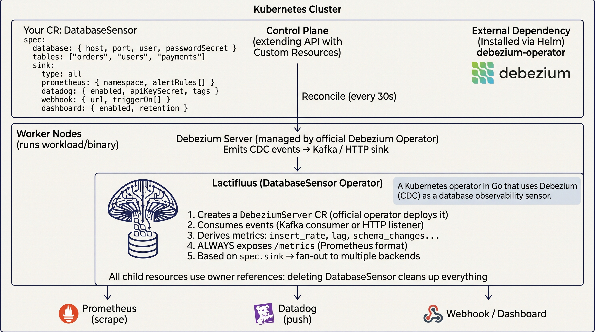

<p align="center">
  
</p>

<h1 align="center">Lactifluus — DatabaseSensor Operator</h1>

<p align="center">
  <b>Inteligencia de CDC basada en políticas, para PostgreSQL en Kubernetes.</b><br>
  Un operator de Kubernetes basado en Debezium (CDC) como sensor de observabilidad de bases de datos.
</p>

<p align="center">
  <picture>
    <source media="(prefers-color-scheme: dark)" srcset="docs/overview/lactifluus-overview-dark.svg">
    
  </picture>
</p>

<p align="center">
  <a href="docs/overview/stakeholder-brief_spanish.md">Resumen técnico para stakeholders</a>: qué se midió, qué está construido pero sin verificar y qué sigue siendo una hipótesis.
</p>

---

> [!WARNING]
> **🚧 Work in progress — no apto para producción.**
> Lactifluus está en desarrollo activo y en etapa temprana (gran parte de las tareas de implementación aún está pendiente). La API del CR `DatabaseSensor`, el chart de Helm y el comportamiento del operator **pueden cambiar sin aviso**. Úsalo para evaluar, experimentar y dar feedback — **no lo despliegues en producción todavía**.

---

## Qué es

**Lactifluus** es un operator de Kubernetes escrito en Go que orquesta observabilidad de bases de datos a partir de Change Data Capture (CDC). Declaras en un YAML "monitorea estas tablas y avísame si X", y el operator orquesta automáticamente Debezium + Prometheus + alertas multi-sink.

Se implementa como el custom resource `DatabaseSensor` y actúa como una **capa de observabilidad** sobre el Debezium Operator oficial: deriva métricas, crea `ServiceMonitor` / `PrometheusRule`, hace fan-out de alertas a múltiples backends y expone un status enriquecido en el CR.

### Problema que resuelve

- **Sin operator:** script cron + `kubectl` + configuración imperativa de Debezium, Prometheus y Alertmanager.
- **Con operator:** un solo YAML declarativo que despliega, monitorea y alerta.

### Diferencia con el Debezium Operator oficial

El oficial (Apache 2.0, Java) solo gestiona el lifecycle de Debezium Server (deploy, scale, config). **No** deriva métricas de observabilidad, no crea `ServiceMonitor` / `AlertRules`, no alerta por patrones de mutación ni expone un status rico. Lactifluus cubre ese gap.

### Prior art y agradecimientos

La idea de CDC-como-observabilidad no es nuestra. El post del blog de los maintainers de Debezium [Detect data mutation patterns with Debezium](https://debezium.io/blog/2024/10/14/Detect-data-mutation-patterns-with-Debezium/) (Mario Fiore Vitale) lo plantea con claridad: derivar señales de negocio directamente del change stream en lugar de instrumentar cada servicio. Lactifluus es la automatización a nivel de operator de esa idea — un solo CR declarativo `DatabaseSensor` en vez de un JMX exporter cableado a mano más un setup de Grafana. Encima añade las señales que Debezium no expone por sí solo: lag derivado, inteligencia de DDL (solo para conectores que emiten cambios de esquema; no PostgreSQL, ver [Métricas derivadas](#métricas-derivadas)) y fan-out de alertas multi-sink. Ver [ADR-013](docs/adr/ADR-013-derived-event-counts-vs-native-jmx-metrics.md) para cómo se relacionan los conteos derivados con los counters nativos de Debezium 3.0.

## Capacidades clave

- Crear y gestionar un `DebeziumServer` (vía el Debezium Operator oficial) desde un solo CR.
- Derivar métricas: `insert_rate`, `update_rate`, `delete_rate`, `lag` y `schema_changes` (no disponible en PostgreSQL, ver [Métricas derivadas](#métricas-derivadas)).
- Exponer `/metrics` (formato Prometheus) **siempre**, independientemente del sink configurado.
- Fan-out de alertas a múltiples backends: Prometheus, Datadog, Webhook/Slack.
- Dashboard embebido con gráficos en vivo.
- **Inspección de la base de datos** opcional: un Job de solo lectura revisa `wal_level`, las tablas y el slot de replicación, y reporta el resultado en `status.snapshot`. Informa y recomienda; no bloquea. Verificado en kind con PostgreSQL 16. Ver [Inspección de la base de datos](#inspección-de-la-base-de-datos).
- **Políticas** explícitas y deterministas (arranque, plan de backfill por tabla, retención de WAL). Cada decisión queda escrita en el `status` con su razón. Son reglas, no aprendizaje automático. El plan de backfill se calcula pero nunca se aplica.
- Status enriquecido visible con `kubectl get`: `Phase`, `Lag`, `EventsPerMin`, `LastError`.
- Bases de datos: PostgreSQL (verificado contra un cluster real) y MySQL (conector mapeado, aún sin verificar). Ver [Bases de datos soportadas](#bases-de-datos-soportadas).

## Arquitectura

<p align="center">
  
</p>

El diagrama de arriba muestra el flujo completo: aplicas un CR `DatabaseSensor`, el reconciler (cada 30s) crea un `DebeziumServer` que el operator oficial de Debezium despliega, los eventos CDC se consumen (Kafka o HTTP), se derivan métricas (`insert_rate`, `lag`, `schema_changes`), se expone siempre `/metrics` en formato Prometheus, y según `spec.sink` se hace fan-out a múltiples backends. Todos los recursos hijos usan owner references, así que borrar el `DatabaseSensor` limpia todo en cascada.

El detalle del bucle de reconciliación:

```
┌─────────────────────────────────────────────────────────────┐
│ User aplica DatabaseSensor CR                                │
└──────────────────────────┬──────────────────────────────────┘
                           │ Reconcile (cada 30s)
                           ▼
┌─────────────────────────────────────────────────────────────┐
│ DatabaseSensor Reconciler (controller-runtime)               │
│   1. EnsureDebeziumServer() → crea el DebeziumServer CR      │
│   2. EnsureServiceMonitor() → Prometheus scrapea /metrics   │
│   3. EnsureAlertRules()     → PrometheusRule (alertas)      │
│   4. EnsureService()        → expone /metrics + /dashboard  │
│   5. Inspección (opcional)  → Job de solo lectura → hechos  │
│   6. HealthCheck()          → pod status + lag              │
│   7. UpdateStatus()         → Phase, Lag, EventsPerMin...   │
└───────────┬───────────────────┬───────────────┬─────────────┘
            ▼                   ▼               ▼
   ┌─────────────────┐  ┌──────────────┐  ┌──────────────┐
   │ Debezium Op.    │  │ Prometheus   │  │ Datadog /    │
   │ (oficial, Java) │  │ Operator     │  │ Webhook      │
   └─────────────────┘  └──────────────┘  └──────────────┘
```

El operator **no** redespliega Debezium desde cero: crea un `DebeziumServer` CR como recurso hijo (con `ownerReference`), y el Debezium Operator oficial maneja el lifecycle. Todos los recursos hijos usan owner references, por lo que borrar el `DatabaseSensor` limpia todo en cascada.

## Ejemplo de uso

```yaml
apiVersion: sensor.io/v1
kind: DatabaseSensor
metadata:
  name: pg-orders
  namespace: prod
spec:
  database:
    type: postgresql        # postgresql | mysql
    host: postgres-svc.prod
    port: 5432
    user: debezium
    passwordSecret: db-creds   # Secret en el mismo namespace, con la contraseña bajo la clave "password"
    name: orders_db         # base a capturar; obligatorio en PostgreSQL
  tables: ["orders", "users", "payments"]

  transport:
    type: http              # http (default) | kafka
    http:
      url: http://db-sensor-operator.db-sensor.svc:8080/cdc   # a dónde Debezium hace POST de los eventos

  snapshot:
    offsetStore: persistent # memory (default) | persistent; ver "Arranque y reinicios"
    inspection:             # opcional, solo PostgreSQL; ver "Inspección de la base de datos"
      enabled: true
      intervalSeconds: 600  # 0 = una vez por cambio de spec; si no, al menos 60
      timeoutSeconds: 30

  sink:
    type: all               # prometheus | datadog | webhook | all
    prometheus:
      namespace: monitoring
      serviceMonitor: true
      alertRules:
        - name: HighLag
          expr: 'debezium_lag_seconds > 30'
          for: 5m
          severity: warning
        - name: NoEvents
          expr: 'rate(debezium_events_total[5m]) == 0'
          for: 15m
          severity: critical
    datadog:
      enabled: true
      apiKeySecret: dd-api-key
      appKeySecret: dd-app-key
      tags: ["env:prod", "db:postgres"]
    webhook:
      enabled: true
      url: https://hooks.slack.com/services/XXX
      triggerOn: [HighLag, NoEvents]

  dashboard:
    enabled: true
    retention: 72h

  thresholds:               # por sensor; omítelo para usar los defaults de abajo
    lagWarn: 30s            # lag >= esto -> Degraded
    lagCrit: 2m             # lag >  esto -> Failed
    noEventWarn: 5m         # sin eventos por este tiempo -> Degraded
    noEventFail: 30m        # sin eventos por este tiempo -> Failed
```

## Thresholds configurables

`spec.thresholds` ajusta los umbrales de salud por DatabaseSensor. Cada campo es
una duración de Go (string) y usa el default del operator cuando no se define,
así que omitir el bloque mantiene el comportamiento actual:

| Campo | Default | Efecto |
|---|---|---|
| `lagWarn` | `30s` | lag mayor o igual → `Degraded` |
| `lagCrit` | `2m` | lag mayor → `Failed` |
| `noEventWarn` | `5m` | sin evento CDC por ese tiempo → `Degraded` |
| `noEventFail` | `30m` | sin evento CDC por ese tiempo → `Failed` |

Los thresholds son **por sensor** (no por tabla). Un valor mal formado cae al
default en lugar de romper el sensor; todavía no hay un webhook de admisión que
los valide.

## Métricas derivadas

| Métrica | Cálculo | Alerta |
|---|---|---|
| `debezium_events_total{op="c"}` (insert) | Count de `op=c` por ventana | `< N/min` → ¿se cayó el tráfico? |
| `debezium_events_total{op="u"}` (update) | Count de `op=u` | `> N/min` → ¿bulk update? |
| `debezium_events_total{op="d"}` (delete) | Count de `op=d` | `> N/min` → ¿borrado masivo? |
| `debezium_schema_changes_total` | Evento DDL detectado (**no en PostgreSQL**, ver abajo) | Cualquier DDL → ¿migración sin aviso? |
| `debezium_lag_seconds` | `now() - ts_ms` del evento | `> 30s` → Debezium se queda atrás |
| `debezium_events_per_minute` | Rate de eventos | — |

Las lecturas de snapshot (`op=r`) nunca se cuentan: reportan filas que ya existían, no cambios.

**DDL en PostgreSQL.** La decodificación lógica de PostgreSQL (`pgoutput`) no transporta DDL, así que el conector de Debezium para PostgreSQL no emite eventos de cambio de esquema. Se probó un `ALTER TABLE` sobre una tabla monitoreada en un cluster real y no generó ninguna serie `debezium_schema_changes_total`. Se espera que los conectores con historial de esquema (como MySQL) sí emitan cambios de esquema, pero solo se probó PostgreSQL.

## Arranque y reinicios

Para PostgreSQL el operator arranca Debezium con `snapshot.mode=no_data`: no lee las filas existentes, así que el sensor reporta desde el primer cambio vivo y no espera a un snapshot. En una tabla de 100.000 filas el snapshot `initial` por defecto dejó a un sensor ciego 57 s, mientras que `no_data` vio el primer cambio en 6 s (Debezium 3.6.3, una corrida; ver `bench/experiments/blind-window/RESULTS.md`). El costo es que las filas existentes no se entregan, lo que no afecta rates, lag ni conteos. Los otros motores conservan el default de Debezium hasta verificar su modo no bloqueante.

Por defecto el Debezium Operator guarda su posición en memoria, así que un reinicio del pod de Debezium puede reentregar eventos recientes e inflar los conteos. `spec.snapshot.offsetStore: persistent` guarda el offset en un PersistentVolumeClaim, y en las pruebas un reinicio ordenado se reanudó sin reentrega. Un kill brusco aún puede repetir hasta un intervalo de flush; eso no se probó. `status.snapshot` muestra la estrategia, el offset store y una razón de una línea. Diseño y evidencia: [ADR-014](docs/adr/ADR-014-snapshot-policy-layer.md).

## Inspección de la base de datos

Es opcional: activa `spec.snapshot.inspection.enabled: true` (viene apagada). Solo PostgreSQL, y requiere `spec.database.name`. El operator ejecuta un Job corto de solo lectura (el binario `/inspector` de la misma imagen), que lee los catálogos de PostgreSQL, y copia el resultado en `status.snapshot`. El Job no tiene token de la API de Kubernetes: devuelve su resultado por el mensaje de terminación del contenedor, el operator es el único que escribe el `status`, y el Job se borra solo después de guardar el resultado.

Qué reporta:

| Condición | Significado |
|---|---|
| `InspectionAvailable` | La inspección corrió, o por qué no pudo (`AuthenticationFailed`, `ConnectionFailed`, `InspectorImageNotConfigured`, ...). Una corrida fallida conserva el error y descarta los hechos anteriores. |
| `LogicalDecodingReady` | `wal_level` vale `logical` |
| `TablesFound` | Todas las tablas listadas existen |
| `SlotRetentionHealthy` | El slot de replicación está sano, en riesgo (`unreserved`) o perdido; `SlotMissing` hasta que Debezium lo crea |

`status.snapshot.inspection` guarda los hechos (filas estimadas, si el usuario puede escribir, el estado del WAL del slot y los bytes retenidos) y `status.snapshot.plan` guarda una opción de backfill por tabla con su razón. El plan siempre dice `applied: false`: todavía no existe un backfill (ver [ADR-014](docs/adr/ADR-014-snapshot-policy-layer.md)).

Conviene saber:

- **Informa; no bloquea.** Debezium se crea haya o no un problema en la inspección.
- **Los hechos del slot piden un intervalo periódico.** Con `intervalSeconds: 0` la primera corrida puede ocurrir antes de que Debezium cree su slot, y el `status` sigue mostrando `SlotMissing`. El valor por defecto (600 s) lo corrige.
- **Instala con el chart de Helm.** El chart define `OPERATOR_IMAGE`, que el Job necesita. Un despliegue con kustomize a secas no lo tiene, y la condición dice `InspectorImageNotConfigured`.
- **Un mensaje de error puede incluir la dirección del servidor y el usuario de la base.** Nunca incluye la contraseña.
- **Los Secrets se leen uno por uno.** El operator no los cachea y su rol solo tiene `get` sobre ellos (sin `list` ni `watch`). Aun así puede leer un Secret por nombre en cualquier namespace; la opción `rbac.namespaced` del chart lo acota, pero no se probó.

Verificado en kind (PostgreSQL 16, un cluster local, 15 comprobaciones, entre ellas una contraseña incorrecta, un namespace con Pod Security `restricted` y el permiso sobre Secrets): ver [`bench/experiments/inspection-e2e/RESULTS.md`](bench/experiments/inspection-e2e/RESULTS.md). Sin verificar: una NetworkPolicy que bloquee el Job, PostgreSQL 12 y 17, MySQL. En esa prueba de Pod Security se rechazaron los pods de Debezium Server que crea el Debezium Operator; el Job del inspector no.

## Status (`kubectl get`)

El CR expone un status enriquecido con el subresource de status:

| Campo | Descripción |
|---|---|
| `phase` | `Pending` → `Running` → `Degraded` → `Failed` |
| `lag` | Duración legible (p. ej. `42s`) |
| `eventsPerMin` | Float con la tasa de eventos |
| `lastEvent` | Tiempo relativo del último evento |
| `lastError` | Mensaje de error (vacío si no hay) |
| `conditions` | `DebeziumAvailable`, `ReceivingEvents`, `Ready` y, si está activa, las condiciones de la inspección |
| `snapshot` | Cómo arranca el conector, el offset store y, con la inspección activa, los hechos y el plan |

## Bases de datos soportadas

| BD | Mecanismo | Estado |
|---|---|---|
| PostgreSQL | Logical decoding (`pgoutput`) | Verificado contra un cluster real (Debezium 3.6.3, PostgreSQL 16) |
| MySQL | Binary log (binlog) | Conector y `database.server.id` mapeados; **aún sin verificar** contra un MySQL real |

Por ahora el operator soporta solo estos dos. La API rechaza cualquier otro `spec.database.type`. Debezium soporta más motores (MongoDB, SQL Server, Oracle, Db2, Cassandra); aquí no están cableados y no se probó nada con ellos. El arranque sin bloqueo, la persistencia del offset y la inspección de la base de datos descritos arriba están implementados solo para PostgreSQL.

## Stack tecnológico

- **Go 1.22+**, **Kubebuilder**, **controller-runtime**, **client-go**
- `github.com/prometheus/client_golang` — métricas Prometheus
- `github.com/tidwall/gjson` — parsing de eventos CDC
- `github.com/segmentio/kafka-go` — Kafka consumer (sink Kafka)
- `github.com/DataDog/datadog-api-client-go` — Datadog API
- Docker multi-stage (`golang:1.22` → `distroless/static`) + Helm chart

## Quick start

### Prerequisitos

Estos operators se instalan **por separado** — el chart de Lactifluus no los incluye:

- Un cluster de Kubernetes.
- **Debezium Operator oficial** (gestiona el lifecycle de Debezium Server).
- **Prometheus Operator** (para los CRDs `ServiceMonitor` y `PrometheusRule`).
- Kafka / Redpanda **opcional** (solo si usas el transporte Kafka; con HTTP, el default, no se necesita broker).

### Instalación

```bash
# 1. Instalar el Debezium Operator oficial
helm repo add debezium https://charts.debezium.io
helm install debezium-operator debezium/debezium-operator -n debezium

# 2. Instalar Lactifluus (crea el namespace en el primer install)
helm install db-sensor ./charts/db-sensor-operator -n db-sensor --create-namespace

# 3. Aplicar un CR de ejemplo
kubectl apply -n db-sensor -f config/samples/v1_databasesensor_basic.yaml

# 4. Ver el status del sensor (shortname: dbsensor)
kubectl get databasesensor -n db-sensor
# NAME                   PHASE     READY   LAG   EVENTS/MIN   DB TYPE
# databasesensor-basic   Pending   False               0     postgresql
```

### Samples

Tres ejemplos listos para `kubectl apply` viven en [`config/samples/`](config/samples/):

| Sample | Qué muestra |
|---|---|
| [`v1_databasesensor_basic.yaml`](config/samples/v1_databasesensor_basic.yaml) | mínimo, sink prometheus-only |
| [`v1_databasesensor.yaml`](config/samples/v1_databasesensor.yaml) | completo: todos los sinks + dashboard + transport |
| [`v1_databasesensor_mysql.yaml`](config/samples/v1_databasesensor_mysql.yaml) | engine MySQL, sink webhook, transport HTTP |

### Demo

Hay una demo local reproducible (kind + eventos CDC sintéticos, sin BD/Debezium/Kafka reales) que
enciende todo el pipeline de observabilidad. Walkthrough documentado con salida real y capturas en
[DEMO.md](DEMO.md); los scripts están en [`demo/`](demo/).

```bash
./demo/setup.sh                                   # kind + CRDs + imagen + helm install
kubectl apply -f demo/sample-databasesensor.yaml
kubectl -n db-sensor port-forward svc/db-sensor-db-sensor-operator-operator-http 8080:8080
./demo/generate-events.sh --burst 60              # eventos sintéticos -> /cdc
open http://localhost:8080/dashboard
```

### Endpoints y puertos

El manager y el servidor HTTP del operator exponen puertos distintos:

| Puerto | Qué sirve |
|---|---|
| `:8080` | servidor HTTP del operator: `/metrics` (siempre), `/dashboard` + `/api/events` (gated por `dashboard.enabled`, 404 cuando está off), `/cdc`, `/healthz`, `/readyz` |
| `:8081` | health probes del manager: `/healthz`, `/readyz` |
| `:8443` | métricas del manager protegidas por kube-RBAC |

### Transporte de eventos

El ingreso de eventos CDC usa **HTTP por defecto** (sin broker, ideal para test/e2e). Para usar Kafka,
basta con cambiar `spec.transport.type: kafka` y rellenar el bloque `kafka` del CR — sin refactor, ya que
downstream solo ve un `CDCEvent`. Es ortogonal a `spec.sink` (la salida de métricas/alertas). Ver
[ADR-012](docs/adr/ADR-012-event-transport-http-default-kafka-optional.md).

### NetworkPolicy & CNI

El chart puede desplegar **opcionalmente** una `NetworkPolicy` que restringe el ingress al puerto de
métricas del operator. Está **OFF por defecto**; se activa con `--set networkPolicy.enabled=true`.

Requiere un **CNI que haga enforcement** de NetworkPolicy (Calico, Cilium, Antrea, Azure CNI). En un CNI
que no lo hace (Flannel plano, el `kindnet` por defecto de kind) la política se instala pero es un **no-op
silencioso** — no bloquea nada. Para verificar que tu CNI aplica políticas, corre un test funcional rápido
de *default-deny* (crea una policy que niegue todo y confirma que el tráfico efectivamente se corta). Para
una auditoría completa contra la spec de NetworkPolicy, usa [Sonobuoy](https://sonobuoy.io/)
(`sonobuoy run --mode e2e --e2e-focus "\[NetworkPolicy\]"`) o
[Cyclonus](https://github.com/mattfenwick/cyclonus). Estas herramientas de auditoría son **referencias**;
este repo no las ejecuta.

### Más documentación

- [DESIGN.MD](DESIGN.MD) — diseño completo (ADRs, diagramas, manejo de errores).
- [ROADMAP.md](ROADMAP.md) — mejoras propuestas, por niveles (trust / competitivo / fleet).
- [docs/TESTING.md](docs/TESTING.md) — guía práctica de testing.
- [ADR-011](docs/adr/ADR-011-hybrid-status-design.md) — status híbrido (conditions + mediciones + phase).
- [ADR-012](docs/adr/ADR-012-event-transport-http-default-kafka-optional.md) — transporte HTTP default / Kafka opcional.
- [ADR-013](docs/adr/ADR-013-derived-event-counts-vs-native-jmx-metrics.md) — derivar conteos del stream vs. métricas nativas JMX.
- [ADR-014](docs/adr/ADR-014-snapshot-policy-layer.md) — arrancar el conector sin snapshot bloqueante, persistir el offset e inspeccionar la base.
- [ADR-015](docs/adr/ADR-015-gradual-adoption-ladder.md) — **borrador de idea**, no una decisión: una escalera de etapas de adopción que se abren por política. No hay nada construido.
- [docs/overview/stakeholder-brief_spanish.md](docs/overview/stakeholder-brief_spanish.md) — resumen técnico para stakeholders ([English](docs/overview/stakeholder-brief.md)).
- [docs/HANDOFF.md](docs/HANDOFF.md) — estado actual y trabajo pendiente.
- [bench/](bench/README.md) — cluster kind, workload y experimentos reproducibles, con sus `RESULTS.md`.
- [docs/articles/to-watermark-or-not.md](docs/articles/to-watermark-or-not.md) — una reflexión sobre los modelos de snapshot en CDC y por qué el operator avanza hacia snapshots incrementales basados en watermarks.

## Desarrollo

```bash
make build        # compilar
make test         # unit + integration (envtest)
make manifests    # regenerar CRD YAML
make generate     # regenerar deepcopy
make docker-build # construir imagen
make deploy       # desplegar en el cluster
make dev          # correr local con envtest
```

### Estrategia de testing

- **Unit (testify):** lógica pura — `LagTracker`, parser de eventos CDC, implementaciones de `Sink`.
- **Integration (envtest):** reconciler contra un API server real — convergencia de estado, owner references, transiciones de status.
- **E2E (kind):** flujo completo — RBAC real, image pull, leader election.

El principio: testear **convergencia**, no acciones ("el estado final es `Running`", no "se llamó a `Create()`"), y verificar idempotencia con el *second reconcile test*.

No hace falta un cluster, una BD, Kafka ni Datadog para la mayoría de los tests: envtest corre un API server en memoria y el pipeline de eventos se prueba con eventos CDC sintéticos y `httptest`. Guía práctica: [docs/TESTING.md](docs/TESTING.md).

## Estructura del proyecto

```
db-sensor-operator/
├── api/v1/                 # Spec/Status structs + kubebuilder markers
├── internal/
│   ├── controller/         # Reconciler principal
│   ├── deployer/           # Crea/actualiza DebeziumServer CR
│   ├── inspection/         # Construye el Job inspector, lee y evalúa su resultado
│   ├── snapshot/           # Consultas del inspector, diagnóstico del slot, plan por tabla
│   ├── metrics/            # /metrics, ServiceMonitor, AlertRules
│   ├── sink/               # Fan-out: Prometheus, Datadog, Webhook
│   ├── health/             # Health check + LagTracker
│   └── events/             # Consumer (Kafka/HTTP) + parser CDC
├── cmd/
│   ├── main.go             # Entry point: manager + reconciler + HTTP server
│   └── inspector/          # Binario inspector de solo lectura (corre como Job)
├── bench/                  # cluster kind, workload y experimentos (reproducibles)
├── docs/                   # ADRs, resumen, artículos, design tokens
├── config/                 # CRD, RBAC, manager, samples
├── charts/                 # Helm chart
├── Dockerfile
├── Makefile
└── DESIGN.MD               # Documento de diseño detallado
```

## Licencia

Lactifluus se distribuye bajo la **Apache License 2.0** — ver [LICENSE](LICENSE). Puedes usarlo, modificarlo y distribuirlo libremente; las contribuciones se aceptan bajo la misma licencia.

- Debezium y el Debezium Operator oficial: Apache 2.0.
- Lactifluus se construye sobre Go, Kubebuilder y controller-runtime; no hereda copyleft de Debezium.

---

<p align="center">
  Para el diseño completo (ADRs, diagramas de secuencia, manejo de errores y plan de desarrollo), consulta <a href="DESIGN.MD">DESIGN.MD</a>.
</p>

<p align="center">
  🌎 <a href="README.md">Read this README in English</a>
</p>
