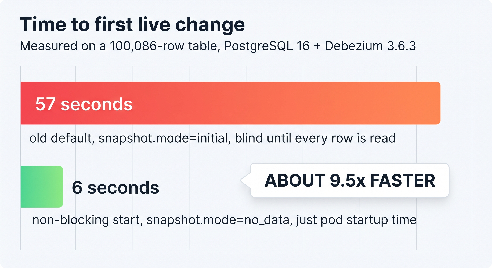
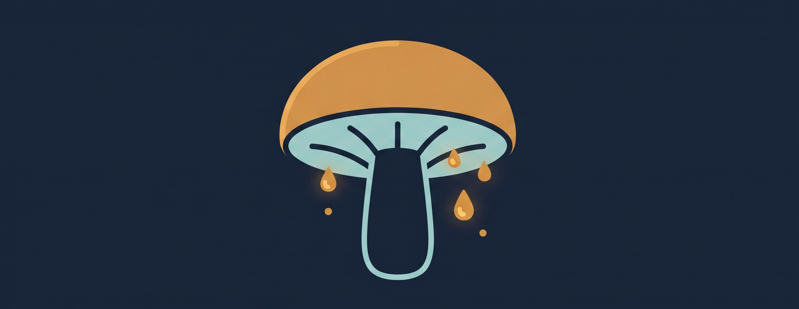

# To Watermark, or Not to Watermark: That Is the Operator's Dilemma

*My monitoring tool was blind for hours after startup. A better idea fixed that.*

I built a Kubernetes operator. It wraps Debezium, watches database tables, and reports metrics. I named it Lactifluus after the milk cap mushroom, because when you break one, it oozes a milky latex, and that's what my operator does when you poke it. It bleeds metrics. Inserts per minute. Update rate. Lag. The whole thing.

For about three months, I thought it was a good idea. A solid idea. The kind of idea where you build it, it works, you feel slightly proud, and you move on.

Then a Debezium maintainer sent me a direct message and said, in essence: the model you're sitting on has an interesting alternative, here's the paper, and also one of the authors is giving a talk today, want to come?

This is how that happened, what the paper actually does, and why it's going to make Lactifluus better.

## The thing I was building

Lactifluus is an operator. You deploy it to a cluster, you create a custom resource that says "observe this table on this database," and it spins up a Debezium connector, points it at the table, and starts streaming change events. From those events, it computes metrics. The operator has a phase field. Pending, Running, Degraded, Failed. Clean. Declarative. The kind of thing that looks good in a slide.

The part with the most room to grow is Pending.

In the Debezium model, when you point a connector at a table for the first time, it does a snapshot. A full, blocking, one-time, "I'm going to read every row in this table before I start streaming" snapshot. On a small table, that's fine. It takes seconds. On a table with two hundred million rows, it takes hours. And during those hours, my operator is in Pending. The lag metric says nothing. The eventsPerMin metric says zero. The sensor is alive, connected, doing its job, and not yet telling you anything.

I watched this happen. Not in a hypothetical. I pointed it at a real table, went to get coffee, came back, and it was still Pending. Went to lunch. Came back. Still Pending. 8 hours. The sensor was quiet all day. And the model said, "That's fine." That's how it works. You bootstrap, then you observe.

I accepted that. For three months, I accepted that. It was the documented default, and it was a reasonable place to start.

## The other tools, and what they have in common

Before I built Lactifluus, I looked at the landscape. Maxwell. SpinalTap. Yelp's MySQL Streamer. Debezium. They all look different on the surface. Maxwell is Go, talks HTTP. SpinalTap is a library, not a service. Debezium is Java, talks Kafka. But the architecture underneath is the same. Each one follows the same two-phase model: snapshot first, stream second. The snapshot is a one-time, blocking, "I need to see the whole table before I can start" operation. The stream is what happens after.

I told myself they all use the same principles, and I was right. They do. The replication protocol is the same. The binlog is the same. The WAL is the same. The difference between them is language, transport, and polish. Not model.

So when I picked Debezium, I wasn't choosing a model. I was making a transport choice. Kafka over HTTP. Java over Go. The model was already decided. The ecosystem decided it for me, because every tool in it inherited it.

## The message

It wasn't a random link in a channel. It was a direct message from a Debezium maintainer, one of the people who ships the tool I built my operator on, and it started with a question that stung more than it should have. Paraphrasing: was the real issue that observability is already a crowded, well-served space, so a new source of metrics has to fight for attention no matter how it's delivered?

Then the maintainer mentioned feedback they'd been hearing: people find that setting up a full CDC pipeline just to get metrics is too much. Then they pointed me to the paper. DBLog. The Netflix one. They noted that the authors had also used their CDC solution for database activity logging. And, almost as an afterthought, that one of the authors was giving a talk that very day, and I might want to join.

I read that on the Metro. Line 2, the blue line, Viaducto, I think, or maybe Portales; it wasn't much further to Taxqueña. Doesn't matter. The car was packed the way CDMX cars are packed, the kind where you're not standing so much as being held by a stranger's backpack and a woman's handbag, and the doors opened and closed and opened, and nobody moved because nobody could. And I was reading, squeezed between a guy eating elote and a teenager with earbuds, a message from a maintainer of the engine I was building on that said, in essence: there's a model with a different gear in it, here's the paper, want to come to the talk?

I got off at my stop. I stood on the platform for a minute before I walked. I was a little uncomfortable. Not in the "I messed up" way. In the "I've been at this for three months, and the person who maintains the engine I'm sitting on just showed me a gear I didn't know existed" way. Which, honestly, is the best kind of discomfort. It's the kind that means there's something to learn.

## Then I read the paper

It was published on the Netflix Tech Blog on October 23, 2019. Andreas Andreakis and Ioannis Papapanagiotou. "DBLog: A Generic Change-Data-Capture Framework." Fourteen pages. I could have finished it in one coffee break.

The paragraph that stopped me said, in essence: DBLog captures changes in real time and takes dumps. The dumps are taken in chunks. The chunks interleave with the real-time events. They don't stall the stream. You can trigger a dump at any time, on any table, via an API.

I read that again. You can trigger a dump at any time. Not "at startup." Not "once, before streaming begins." At any time. While the stream is already flowing. While the sensor is already reporting. While the table is already being observed.

The model is not snapshot-then-stream. The model is stream-always, with optional interleaved chunked reads. The full state fills in in the background. The sensor is useful from the first log event. There is no Pending phase. There is no "wait for the bootstrap."

And it's been public since 2019.

## How the watermark actually works

I'm going to explain this the way I understood it, which probably isn't how the paper explains it, but it's how it clicked for me.

The problem: you're reading a table page while the database is actively being written to. You don't know exactly when your SELECT executed relative to the writes. You know it happened somewhere between two moments, but you can't point to the exact log position.

The solution is almost embarrassingly simple. There's a table with one row and one column. A UUID. To read a chunk of your target table, you write a new UUID into that one-row table. That write shows up in the transaction log. That's your low watermark. Then you run your SELECT on the chunk. Then you write another UUID. That's your high watermark. Now you have a window in the log. Your SELECT definitely happened somewhere inside it.

Then, for reconciliation, you look at every log event between those two watermarks. For any of them whose primary key matches a row in your chunk, you discard your chunk's version. The log event is newer, so it wins. The rows that don't collide with any log event in the window? Those are safe. Nobody touched them while you were reading. You emit them as current state.

That's it. A one-row table, two UUID writes, and a deduplication pass. No locks. No MVCC snapshot isolation. No SELECT ... FOR UPDATE. Just a marker in the log and a "if the log says it changed, the log wins" rule.

The read-only variant, which matters for me, replaces the "write a UUID to a table" step with "sample the GTID set" on MySQL or "sample the transaction ID" on PostgreSQL. Same window, same deduplication, but you never write to the database. You just look at the log's own coordinates before and after your SELECT.

For the uninitiated, a GTID is a Global Transaction Identifier. MySQL assigns one to every committed transaction. It's a UUID plus a sequence number. Every binlog event carries its GTID in the header. So when you sample @@gtid_executed before your SELECT and again after, the difference between the two sets is precisely the set of transactions that committed while you were reading. No file offsets. No byte positions. Just "which transactions happened in my window."

## What it does and doesn't guarantee

I want to be precise here, because this is where people get confused.

The watermark guarantees state consistency. Once all chunks are complete and the high watermark has consumed the log, your reconstructed state matches the source database at a specific point in time. No row is stale. The log always wins.

It does not guarantee exactly-once delivery. If you crash mid-chunk, you re-emit rows. If the connector restarts, you replay from the last committed offset. Debezium's own documentation says "at-least-once delivery semantics still apply."

So you will never see an incorrect state, but you might see the same event twice.

And here's why that's the right guarantee for an observability sensor: I don't care about exactly-once events. I care about "what is the table doing right now." A duplicate insert event doesn't change my answer to "is this table hot or cold." An eventsPerMin metric that counts a row twice in a burst window is a rounding error, not a correctness failure. What I can't tolerate is a stale row making me think the table is quiet when it's actually on fire. The watermark kills that failure mode.

The one place it bites: if my sink is append-only, duplicates accumulate, and my metrics drift upward over restarts. So my metrics need to be idempotent. Computed from state, not from event count. That's a design constraint the watermark doesn't solve for me, but it's a constraint I can design around. And the classic snapshot model doesn't even let me think about it, because in that model, the snapshot is a one-time thing, the stream is at-least-once by design, and nobody questions it.

## The irony

Debezium shipped incremental snapshots in version 1.6, in June 2021. About twenty months after the Netflix post. They called it "incremental snapshots." The algorithm is the same. The watermark is the same. The chunked SELECT interleaved with the log stream is the same.

Read-only incremental snapshots came next for MySQL: Debezium's own blog says the MySQL connector supported them as of version 1.7. The Shopify engineering team later documented how that read-only implementation works in a Debezium blog post from April 2022, and it is the best explanation of the GTID-based variant I found. For PostgreSQL, read-only support arrived later, in a relatively recent 2.x release, and support for running incremental snapshots against read-only *replicas* is newer still. Exact versions matter here and they move, so verify against the release notes for your own connector rather than trusting my memory.

And nobody in my corner of the ecosystem flinched. The Debezium community celebrated it as a new feature. The Kafka community wrote blog posts about it. The Kubernetes operator people, the people building observability tools on top of Debezium, the people who might have said "wait, this changes the phase model, this changes what 'Pending' means, this changes the entire assumption that the sensor is blind during bootstrap" - mostly didn't say it. Myself included. They added a signal you can send. execute-snapshot. Done. Next feature.

I was building on the default. snapshot.mode=initial. The blocking one. The one that makes my sensor quiet for hours. And I thought that was just how it was. That was just the cost of CDC. You pay the bootstrap tax, and then you get your metrics.

I didn't know I was paying a tax that didn't have to exist. Now I do, and that's the fun part: now I get to fix it.

## What I'm actually going to do

I'm not going to rip out Debezium. I'm not going to hand-roll a watermark in Go. The algorithm is solid; it's been battle-tested, and Debezium already implements it. There are also independent implementations. pgcapture runs the DBLog algorithm in Go for PostgreSQL, and it does something even better: it reads from a logical replica instead of the source database, so it doesn't touch your primary at all.

One caveat I'll state plainly: read-only incremental snapshots for PostgreSQL only exist in a relatively recent 2.x release of Debezium (and read-only replica support is newer still). If your operator pins an older version, that path doesn't exist yet, and your only option for read-only connections is "no snapshot, stream only," which means you're blind to existing rows. So I'm pinning a recent enough version. If you're not, that's your first upgrade, and it's not optional. Check the exact version against your own connector before you rely on it.

**Update, a few weeks later: most of this is built now, not just planned.** The rest of this section is how I described the plan when I wrote it. Skip to the next section if you only want the current state.

What I set out to do was make Lactifluus a policy layer.

The operator looks at the table. It asks the database a few questions. How big is this table? Do I have write access? What's the current GTID set? Is GTID even enabled? Based on the answers, it picks the capture strategy.

One detail worth getting right: incremental snapshots are not a snapshot mode. You start the connector with a mode that skips the blocking read of existing rows, and then you ask Debezium to fill those rows in by sending it an execute-snapshot signal. The connector keeps streaming the whole time. So the policy layer makes two decisions: how to start the connector, and whether and how to send that signal. (Snapshot mode names differ by connector and version, so check yours. On Debezium 3.6.3 the PostgreSQL connector rejects `never` and accepts `no_data`; I checked.)

Small table? Skip the blocking snapshot and just stream, for example snapshot.mode=no_data. The snapshot is a non-event. The sensor is useful in the first ten seconds.

Big table, write access? Start without the blocking snapshot, give the connector a signaling table (signal.data.collection), and send an execute-snapshot signal. Debezium writes its low and high watermarks into that table, and the chunks fill in in the background. The sensor is useful from the first log event.

Big table, read-only? Same idea, but no writes to the database. On MySQL that means read.only=true with GTIDs enabled, the signal sent through a Kafka topic (signal.kafka.topic) instead of the signaling table, and watermarks that are GTID sets. On PostgreSQL the read-only path samples transaction IDs and needs a recent enough 2.x release. The sensor is still useful from the first log event.

GTID not enabled, no write access? phase: Degraded, with a reason: "Cannot use read-only watermark, GTID not enabled, no write access for signal table." The user knows why the sensor is limited. It's not a mystery. It's not a four-hour wait. It's a one-line explanation.

The "spike" - and I mean the word "spike" in its engineering sense, a small throwaway proof - is a switch statement at the top of Reconcile(). Two SHOW queries. A size check. A privilege check. And a generated Debezium connector spec that matches the situation. One table. One connection. An afternoon of work. If it works, I've proven my thesis. If it doesn't, I know where the friction is before I commit to a full refactor.

The watermark itself is still Debezium's job. My operator just chooses which watermark mode to use. I'm not reimplementing the algorithm. I'm adding a decision step that currently doesn't exist. The reconcile loop goes from "generate a static spec" to "inspect, decide, generate a spec."

By the way. A policy layer is an operator. They're not in tension.

The K8S operator pattern is: watch a CRD, inspect the world, decide what to do, reconcile. That's the whole thing. Right now your Reconcile() does "inspect the world" (is the connector running?) and "decide what to do" (it doesn't - the decision is baked into the spec you generate statically). Adding the policy layer just means the "decide" step gets real. You inspect the table, the connection, the GTID status, and then generate the spec.

So: still an operator. Just one with a brain instead of a reflex.

## Where it actually landed

Phase A shipped first, and it is the default today: the connector starts with `snapshot.mode=no_data`, so there is no blocking read and no `Pending` wait. Snapshot-era events are kept out of the lag calculation. A persistent offset store survives a Debezium restart, which matters more than it sounds: with the in-memory store the Debezium Operator's config used by default, one live event got re-delivered after a graceful restart, and that silently inflated my own counters. That alone was worth fixing before anything fancier.

Phase B, the part of this article that talks about inspecting the table and choosing a strategy, is built but not switched on. The inspector exists: it asks PostgreSQL how big a table is, whether the connection can write to it, what the WAL retention headroom looks like, whether the row-count estimate is stale. The decision logic exists too, as a pure function from those facts to a strategy. It ran end to end in a kind cluster and passed. What it does not have yet is a reason to run: the plan it produces is recorded in the sensor's status with `applied: false`, because nothing downstream consumes a backfilled row. The operator today reports metrics from the live stream; it does not need the old rows to do that. Turning Phase B on before something needs it would be shipping a feature nobody asked for, which is the opposite of the lesson this whole article is about.

Two things from the original plan turned out to be wrong in the small print, which is worth saying plainly instead of quietly fixing it in the code and never mentioning it. `snapshot.mode=incremental` is not a real setting; incremental snapshots are triggered by sending an `execute-snapshot` signal while the connector runs with a mode that skips the blocking read. And the MySQL read-only dates I wrote from memory were off: I'd said 1.8/April 2022, and the actual read-only MySQL support landed in 1.7, with Shopify's engineering team documenting the GTID-based mechanics in that April 2022 post I link below. PostgreSQL's own read-only path, and read-only *replica* support specifically, is newer still, and I'm not going to repeat a version number here without checking it against the release notes at the time you read this, because Debezium ships quickly and I've already been burned once this article.

## The thing I keep coming back to

The snapshot-then-stream model is a legacy. It's from a time when the only way to see a table was to read it all at once. It's like insisting on a full backup before you're allowed to monitor a system. It's not a physical law. It's an implementation artifact that got calcified into an architectural assumption, and then the assumption got inherited by every tool that came after, and then the tools got wrapped in operators, and then the operators got deployed to production, and by the time anyone noticed the assumption could be questioned, a lot of metrics pipelines already depended on it.

DBLog broke the assumption in 2019. Debezium shipped it in 2021. Read-only support for PostgreSQL followed in a later 2.x release. And I was building on the older model without knowing, because the model is invisible. You can't see it in the docs. It's the shape of the state machine. It's the phase field. It's the fact that Pending exists at all.

I made Pending go away. Not by deleting the state; a sensor can still land there for other reasons. By making the default start smart enough that the sensor never needs to sit there waiting on a snapshot in the first place. It goes straight toward Running on the first log event. The snapshot is just background noise. The sensor bleeds metrics from the second one.

Measured, on a 100,086-row table in a local cluster: the old default made the sensor blind for 57 seconds before it saw its first live change, because every row had to be read and delivered first. With the non-blocking start, that dropped to 6 seconds, which is just the pod coming up. At 1,750 rows a second, the rate I measured on that run, a 10-million-row table under the old default would be blind for something like an hour and a half. I didn't run that table; I'm extrapolating, and I'm saying so instead of quietly presenting it as measured. But it's the right order of magnitude to explain why the fix mattered more than a 51-second improvement on a small table would suggest.

That's the whole article. The rest is just me telling you how I got here, which you already read. And that's the point of building in public: you ship what you understand today, you listen, and you iterate.

The milk cap doesn't know it's a mushroom. It just oozes. That's fine. That's what a sensor is.

Until next,
Alex

## References

- Maxwell, SpinalTap, Yelp's MySQL Streamer, and Debezium.
- Netflix Tech Blog, *DBLog: A Generic Change-Data-Capture Framework* (2019): <https://netflixtechblog.com/dblog-a-generic-change-data-capture-framework-69351fb9099b>
- Debezium blog, *Incremental Snapshots in Debezium*: <https://debezium.io/blog/2021/10/07/incremental-snapshots/>
- Debezium blog, *Read-only Incremental Snapshots for MySQL* (April 2022): <https://debezium.io/blog/2022/04/07/read-only-incremental-snapshots/>
- The blind-window numbers in this piece are from a measured run in this project's own benchmark: `bench/experiments/blind-window/RESULTS.md`. The design this whole article led to is written up as [ADR-014](../adr/ADR-014-snapshot-policy-layer.md).