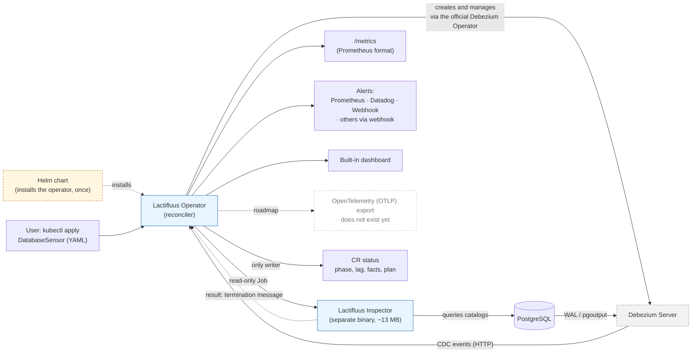
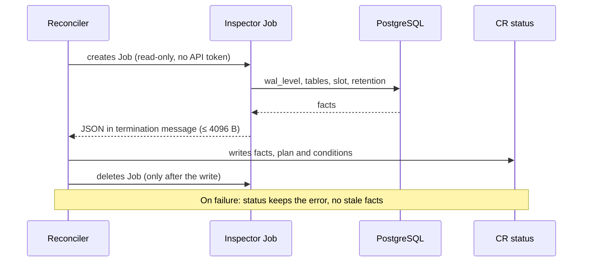

# Lactifluus: technical brief for stakeholders

Date: 2026-10-31 · Status: branch `feat/snapshot-policy-phase-b` (CI green, not merged) · [Versión en español](stakeholder-brief_spanish.md)
Author: Alejandro Mercado Peña

<picture>
  <source media="(prefers-color-scheme: dark)" srcset="lactifluus-overview-dark.svg">
  
</picture>

This document keeps three things apart so none is mistaken for another: what we **measured**, what we **built but have not yet tested end to end**, and what is a **market hypothesis** still to validate. Technical terms are explained in the [glossary](#11-glossary) at the end.

## 1. In one sentence

**Policy-based CDC intelligence for PostgreSQL on Kubernetes.**
*Explicit rules, not a black box: it checks your database, starts without going blind, and explains every decision. Today it checks and recommends; the direction is to act on those policies.*

Lactifluus is a Kubernetes operator that observes a database **without touching application code**: you declare in YAML which tables to watch, and it deploys Debezium, derives metrics, flags anomalies, and **inspects the database and reports whether it is ready to be watched**.

### What if the inspection says it is not ready?

Today it **reports, it does not block**. The inspection is optional (off by default), runs asynchronously, and leaves its verdict in the resource's `status`: conditions such as `LogicalDecodingReady=False` or `SlotRetentionHealthy=False`, each with a reason. The user decides what to do: fix the database (for example, set `wal_level=logical`), leave it as is, or delete the sensor.

What it does **not** do yet:

- It does not prevent Debezium from being created, in either of these two different kinds of "failure":
  - **The database does not pass the check**: the inspection worked and found a problem (wrong `wal_level`, a missing table, a slot at risk). It shows up as a condition set to `False`, with its reason.
  - **The inspection itself could not run**: an internal or access error (could not connect, password rejected, timed out). It shows up as `InspectionAvailable=False` with the error code, and with no stale data that could mislead.
- It does not apply any fix or stop the process on its own.

A "brake" (for example, do not start while the database is not ready, or ask for confirmation) is an open product decision. We have not built it because blocking automatically on a diagnosis we have not yet tested end to end in a real cluster would be riskier than reporting. It is a question for the first conversations (section 7).

## 2. The pivot

Lactifluus still gives metrics and alerts. What changes is the **emphasis**: the hard part of adopting CDC is not the metrics, it is **the risk of putting it on a production database**. So the product moves from "I show you what is happening" to "I help you adopt it without surprises and I explain why".

This comes from two things told in the [article](../articles/to-watermark-or-not.md) we wrote from several sources: watching a sensor stuck in `Pending` for 8 hours because of a blocking snapshot on a large table, and a conversation with a Debezium maintainer about an alternative approach (watermarks). It is a builder's reflection, **not a market finding**: we have not yet asked users.

Measures to tackle that risk:

| Adopter's fear | What Lactifluus does now |
|---|---|
| "It goes blind while it copies my big table" | Starts without copying existing data (`no_data`) |
| "A restart duplicates events and my counts lie" | Persistent offset: an orderly restart does not redeliver |
| "The replication slot can fill my disk" | Reads the slot state and diagnoses WAL risk |
| "I don't know if my database is ready" | Inspects [`wal_level`](#11-glossary), tables, permissions, estimated size |
| "I don't know why it is Degraded" | `status` explains strategy, offset and cause in one line |

Unsure about a term (slot, WAL, offset)? See the [glossary](#11-glossary).

## 3. Architecture

**Who is who:**

- **Lactifluus Operator** (ours, blue): the reconciler that reads your YAML and orchestrates everything else.
- **Lactifluus Inspector** (ours, blue): a small binary, separate from the operator, that runs as a read-only Job. It is not a second operator.
- **Official Debezium Operator** (third party, grey): we orchestrate it, we did not write it. It deploys and maintains Debezium Server.
- **OpenTelemetry export** (white, dotted): on the roadmap and **does not exist yet**. Shown to indicate direction.
- **Helm** (orange, dashed): used only to install the operator in the cluster. Day-to-day use is `kubectl apply` of a `DatabaseSensor`.

Having our operator **govern another operator** declaratively (one YAML instead of configuring Debezium, Prometheus and alerts separately) is part of what it offers.

### Two design rules, and why they matter

**1. One writer of state.** The inspector does not talk to the Kubernetes API: it leaves its result in the pod's termination message and the operator copies it into `status`.

- *Why it is good:* the pod that receives the database password has no permissions on the cluster, so if it is compromised it cannot modify it. There is also a single place to look and audit.
- *Cost:* the result must fit in 4096 bytes (with many tables it is trimmed and flagged), and the operator must copy it before the pod disappears.

**2. The schema does not run ahead of its producer.** We do not publish API fields that nothing fills yet.

- *Why it is good:* we do not promise capabilities that do not exist, and we avoid breaking changes later. What you see in the CRD is what the operator does.
- *Cost:* the API looks smaller than it will be; for example, the backfill plan is computed but not applied (section 6).

## 4. The start-up problem, measured

A table of 100,086 rows, PostgreSQL 16, Debezium 3.6.3, one [kind](#11-glossary) cluster, one run per mode.

```mermaid
gantt
    title Time until the first live change is seen (s)
    dateFormat  X
    axisFormat  %s s
    section initial snapshot
    blind while copying the table :crit, 0, 57
    section no_data (our default)
    pod start :active, 0, 6
```

| Mode | First live change | Rows copied first |
|---|---|---|
| `initial` | 57 s | 100,089 |
| `no_data` | 6 s | 0 |

Honest reading: at about 1,750 rows/s, a 10-million-row table would be blind for roughly 95 minutes. **That is an extrapolation and was not run.** An earlier run measured 110 s from a cold image pull, so the spread is real.

## 5. The inspection cycle

What the slot diagnosis detects today (tested against a real PostgreSQL 16): missing, inactive, at risk (`unreserved`), lost (`lost`), and extended retention. With `max_slot_wal_keep_size = -1` the slot is never invalidated by size, but the disk can fill; the diagnosis says so and warns that setting a cap can invalidate a slot that already retains more than the cap.

## 6. Verification status

| Capability | Evidence |
|---|---|
| Exact CDC counts (252/205/43), lag ~0.2 s | Measured in kind with real Debezium |
| Start without blindness (`no_data`) | Measured, 100k-row table |
| Orderly restart without redelivery | Measured by count, not by row key |
| Slot and table diagnosis | Tested against a real PostgreSQL 16 |
| Operator → Job → status flow | Integration tests with a fabricated pod; CI green |
| **Real operator creating the Job in kind** | **Not tested yet** |
| MySQL | Mapped in the deployer, **never run** |
| Hard restart (kill/OOM) | **Not tested** |
| Kafka as transport | **Not tested** |
| PostgreSQL 12 and 17, replicas | **Not tested** |

Limits worth saying out loud rather than hiding:

- **Schema changes (DDL) are not visible on PostgreSQL** with this method; a real `ALTER TABLE` produced no signal.
- **Backfill (safely copying existing data) is deferred**: today the plan is computed but not applied, because no feature consumes it yet.
- An [idle table](#11-glossary) shows `Degraded` after 30 s; this is an open product decision.
- One security finding is unresolved: the operator caches every Secret in the cluster, which weakens the password isolation the Job design promises.

## 7. Product-fit hypotheses (to validate, not facts)

None of these has market evidence yet.

1. Platform/SRE teams running **PostgreSQL** on Kubernetes feel the pain of "I don't know if it is safe to turn on CDC". (Today the scope is PostgreSQL and MySQL: PostgreSQL is measured; MySQL is mapped but unverified. Other engines are outside the current scope; see the [roadmap](../../ROADMAP.md).)
2. They would adopt, or pay, for **adoption safety** (pre-checks, no blindness) more than for metrics.
3. "No application code changes" outweighs the comparison with [polling or triggers](#11-glossary).
4. A "brake" on a database that is not ready (section 1) is something they want, or they prefer to just be notified.

### Questions for the first conversations

Many teams **do not know what CDC is**, and that is valuable information. Start from the pain without naming the technology, and explain CDC in one line only if needed ("reading the changes of a database from its own transaction log, without querying it or touching the app").

Without mentioning CDC:

- If someone deletes or updates thousands of rows by mistake, how does your team find out today, and how long does it take?
- If someone changes a table's schema, how do you detect it?
- How much of your database monitoring comes from the application and how much from the database itself?

If they already know CDC:

- Do you use it today? If not, what holds you back: production risk, operations, or cost?
- Has a replication slot ever filled your disk? How did you find out?
- How large are your tables, and how long a blind window can you tolerate?

On scope and integration:

- Which engine besides PostgreSQL? (MySQL is next and still unverified.)
- Would you rather have this as its own operator or connected to your current monitoring (Prometheus, Datadog, Zabbix, other)? See the technical note in section 8.

## 8. Technical note: own operator, or integrated with existing monitoring?

The question is where the intelligence lives: is Lactifluus the system that deploys, measures and alerts, or a signal provider for the system the customer already has (Prometheus, Datadog, Zabbix, Grafana)?

**What the product does today (verified in code and tests):**

- Always exposes `/metrics` in Prometheus format, whatever sink is configured.
- Can create a `ServiceMonitor` and a `PrometheusRule` (requires the Prometheus Operator).
- Can push metrics and alerts to Datadog through its API, and send a JSON webhook.
- Ships a built-in dashboard and a `status` visible with `kubectl`.
- Does not export OpenTelemetry (OTLP) yet: it is on the roadmap. It would be the path to reach Datadog, Grafana Cloud, Honeycomb and others through one route instead of integrating each.
- Has no native Zabbix integration. Zabbix can read Prometheus-format endpoints, but **we have not tested it**.

**Two ways to position it:**

| | A. Own operator (deploys and alerts) | B. Signal provider (exports only) |
|---|---|---|
| What it is | A `DatabaseSensor` resource that does it all | An exporter that feeds the existing monitoring |
| For | Clear, measurable value from day one; one YAML; the adoption diagnosis lives here | Fits their stack without asking for changes; less approval friction; does not compete with their tools |
| Against | Asks them to trust one more tool and run another component in production; overlaps with what they have | The differentiating value (inspection, safe start) gets diluted; easier to replace with a generic exporter |
| Risk | Rejection as "yet another system" | Becomes a commodity |
| Best if the customer… | Has no mature database monitoring, or wants something declarative on Kubernetes | Already has Prometheus/Datadog/Zabbix well established with alerts defined |

**Proposed reading (a hypothesis, not data):** the product already supports both because `/metrics` is always on. The real differentiator is not the metrics but **adoption safety** (sections 1 and 2), and that only exists if we deploy and diagnose. So the reasonable bet is to lead with A and keep B as a low-risk way in ("plug it into what you already have"). It must be validated in the conversations before deciding.

**If they use Zabbix or something else:**

- The cheapest path is for their system to read `/metrics` (Prometheus format), if it supports it. To be verified with each tool.
- The generic webhook could feed other tools through an adapter. Also untested.
- If the customer needs a native connector, that is a product decision with a maintenance cost; measure demand before building it.

## 9. Next steps

1. End-to-end test of the real operator in kind (blocks the merge).
2. Close the Secret-cache finding.
3. Verify PostgreSQL 12 and 17, and MySQL, before promising them.
4. Decide the idle-table behaviour and rewrite the benchmark thesis (DDL no longer differentiates CDC).
5. Decide whether the inspection should block start-up or only report (section 1).
6. Decide whether to open the PR to `main`.

Technical detail and decisions: `docs/adr/ADR-014-snapshot-policy-layer.md` · pending work: `docs/HANDOFF.md` · reproducible experiments: `bench/experiments/*/RESULTS.md`.

## 10. Closing: why this approach is better

**Is it a "brain"? No, and it should not be sold as one.** At this moment there is no use of AI or machine learning. What we have are **policies**: explicit, deterministic rules that look at the database's facts and decide or recommend something. Today there are three:

1. **Start-up policy:** how to begin observing without going blind (on PostgreSQL, no initial copy).
2. **Per-table backfill policy:** whether a table is small, large, or unreliable to measure, and which loading strategy would apply. Today it is computed and shown, **not applied**: it calculates and recommends; execution comes later. It will be built when something needs the existing rows, when the Kafka transport is wired, or when a user asks for it.
3. **WAL retention policy:** whether the slot is healthy, at risk, or lost, and what to do.

Being rules rather than a black box is an **advantage**, not a limitation: every decision is written in `status` with its reason, and can be read, tested and audited. "Policy-based CDC intelligence" describes this without overstating it.

**What improves over the previous approach (metrics only):**

| Before | Now | Evidence |
|---|---|---|
| CDC is switched on and problems surface in production | The database is inspected and reported on before it is trusted | Tested against PostgreSQL 16; kind e2e missing |
| A large snapshot leaves the sensor blind | It starts seeing live changes | 57 s → 6 s on 100k rows |
| A restart can duplicate counts | Orderly restart without redelivery | Measured by count |
| A lagging slot can fill the disk without a clear warning | WAL risk is diagnosed and explained | Tested against PostgreSQL 16 |
| "It is Degraded" with no explanation | `status` gives strategy, cause and reason | Verified in integration tests |

**What we do not claim:**

- It does not fix the database by itself or block start-up (yet).
- It does not see schema changes (DDL) on PostgreSQL.
- Only PostgreSQL is measured; MySQL is mapped but unverified.
- None of this has market validation yet (section 7).

### AI on the horizon (see the [roadmap](../../ROADMAP.md))

We use no AI today, and that is deliberate. It remains a line of exploration, **not a commitment**: it is under constant evaluation, but other priorities must be consolidated first. Two rules are set:

- **No external LLM.** Sending schemas, table names or data to a third-party service is an unacceptable security risk for a tool that runs next to production databases. If it is ever explored, it would have to be a local or self-hosted model, and that viability is **not evaluated**.
- **Rules decide; AI, at most, suggests**, with a person approving. And it would start with metrics only, with no rows or sensitive data.

Possible uses, in no priority order: anomaly detection (starting statistical, as the roadmap already says), explaining a diagnosis in natural language, and suggesting configuration changes.

**In two sentences:** adopting CDC is often scary because it is done blind. Lactifluus turns it into a declarative process that checks first, starts without going blind, and explains every decision with a reason.

## 11. Glossary

| Term | What it means |
|---|---|
| **CDC** (Change Data Capture) | Reading the changes of a database (inserts, updates, deletes) from its own transaction log, without querying the tables or touching the application. |
| **Debezium** | Open-source tool that does CDC and publishes the changes as events. Lactifluus deploys and manages it. |
| **WAL** (Write-Ahead Log) | PostgreSQL's transaction log. Debezium reads it to see the changes. |
| **Replication slot** | A marker in PostgreSQL that tells the database "keep the WAL until this reader has read it". If the reader falls behind or stops, WAL piles up and can **fill the disk**; if it piles up too much, the slot can be invalidated. |
| **Snapshot** | The initial copy of existing rows that Debezium makes when it connects. On large tables it can take long and leave the sensor blind. |
| **`no_data`** | Snapshot mode that copies no existing rows: it only sees changes from the moment it starts. |
| **Offset** | The position up to which Debezium has already read. If it is lost on a restart, events may be redelivered and counts duplicated. |
| **Backfill** | Loading the data that existed before observation began. Deferred in this product. |
| **DDL** | Schema changes (`ALTER TABLE`, `CREATE`…). Not visible on PostgreSQL with this method. |
| **`wal_level`** | A PostgreSQL setting that defines how much information it writes to the WAL. For CDC it must be `logical`; with any other value Debezium cannot create its replication slot. |
| **Lag** | The delay between a change happening and us seeing it. |
| **Idle table** | A table with no writes. Since lag is measured against the last event, a quiet table looks "behind" and goes to `Degraded` even though nothing is wrong. |
| **Operator / reconciler** | A Kubernetes program that continuously drives the real state toward the state declared in a YAML. |
| **CRD / CR** | A custom resource type (`DatabaseSensor`) and each instance the user creates. |
| **Job** | A Kubernetes task that runs once and finishes. The inspector runs as a Job. |
| **Termination message** | Short text (max 4096 bytes) a container leaves when it ends; Kubernetes stores it on the pod. This is how the inspector's result travels. |
| **kind** | "Kubernetes in Docker": a local test cluster. All our measurements ran on one, not in production. |
| **Prometheus / Datadog / Zabbix** | Monitoring and alerting systems. Prometheus reads metrics from a `/metrics` endpoint; Datadog receives data through an API; Zabbix is another monitoring system. |
| **Polling** | Querying the database every so often to see what changed. Simple, but misses intermediate changes and adds load. |
| **Triggers** | Code inside the database that runs on every change and records it. Sees everything, but adds cost to every write and requires modifying the database. |
