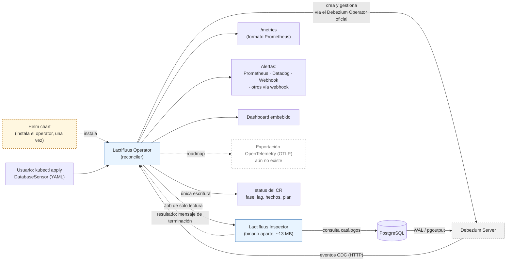
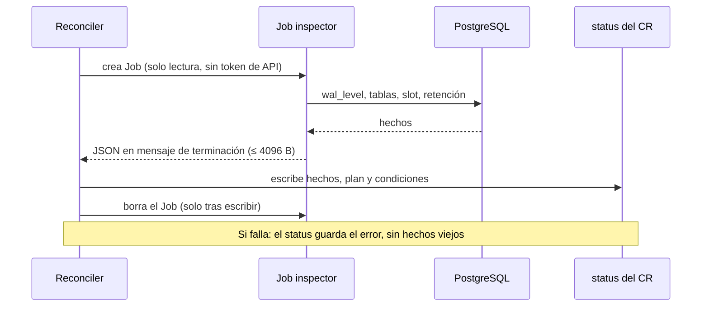

# Lactifluus: resumen técnico para stakeholders

Fecha: 2026-10-31 · Estado: rama `feat/snapshot-policy-phase-b` (CI en verde, sin mergear) · [English version](stakeholder-brief.md)
Autor: Alejandro Mercado Peña

Este documento separa tres cosas para que no se confundan: lo que **medimos**, lo que **construimos pero aún no probamos de punta a punta**, y lo que son **hipótesis de mercado** por validar. Los términos técnicos están explicados en el [glosario](#11-glosario) al final.

<picture>
  <source media="(prefers-color-scheme: dark)" srcset="lactifluus-overview-dark.svg">
  
</picture>

*Resumen. Borde sólido: construido y verificado. Discontinuo: construido, aún sin probar de punta a punta. Punteado: roadmap. Versiones clara y oscura: `lactifluus-overview-light.svg` y `lactifluus-overview-dark.svg`.*

## 1. En una frase

**Inteligencia de CDC basada en políticas, para PostgreSQL en Kubernetes.**
*Reglas explícitas, no una caja negra: revisa tu base, arranca sin cegarse y explica cada decisión. Hoy revisa y recomienda; la dirección es actuar según esas políticas.*

Lactifluus es un operator de Kubernetes que observa una base de datos **sin tocar el código de la aplicación**: declaras en un YAML las tablas a vigilar y él despliega Debezium, deriva métricas, avisa de anomalías e **inspecciona la base y te informa si está lista para ser vigilada**.

### ¿Y si la inspección dice que no está lista?

Hoy **informa, no bloquea**. La inspección es opcional (viene apagada), corre de forma asíncrona y deja su veredicto en el `status` del recurso: condiciones como `LogicalDecodingReady=False` o `SlotRetentionHealthy=False`, con la razón. El usuario decide qué hacer: corregir la base (por ejemplo, activar `wal_level=logical`), dejarlo así o borrar el sensor.

Lo que **no** hace todavía:

- No impide que se cree Debezium, en ninguno de estos dos casos distintos de "falla":
  - **La base no pasa la revisión**: la inspección funcionó y encontró un problema (`wal_level` incorrecto, una tabla que no existe, un slot en riesgo). Queda como condición en `False` con su razón.
  - **La inspección misma no pudo correr**: error interno o de acceso (no se conectó, la contraseña fue rechazada, se acabó el tiempo). Queda `InspectionAvailable=False` con el código del error, y sin datos viejos que puedan confundir.
- No aplica por sí sola ninguna corrección ni detiene el proceso.

Un "freno" (por ejemplo, no arrancar mientras la base no esté lista, o pedir confirmación) es una decisión de producto abierta. La razón de no haberlo hecho aún: bloquear automáticamente con un diagnóstico que todavía no probamos de punta a punta en un cluster real sería más riesgoso que informar. Es una pregunta para las primeras conversaciones (sección 7).

## 2. El giro

Lactifluus sigue dando métricas y alertas. Lo que cambia es el **énfasis**: la parte difícil de adoptar CDC no son las métricas, es **el riesgo de ponerlo en una base de producción**. Por eso el producto pasa de "te muestro lo que pasa" a "te ayudo a adoptarlo sin sustos y te explico por qué".

Esta idea nace de dos cosas que cuenta el [artículo](../articles/to-watermark-or-not.md) que redactamos a partir de distintas fuentes: ver un sensor atascado en `Pending` durante 8 horas por un snapshot bloqueante en una tabla grande, y una conversación con un maintainer de Debezium sobre un enfoque alternativo (watermarks). Es una reflexión de construcción, **no un hallazgo de mercado**: todavía no hemos preguntado a usuarios.

Medidas para atacar ese riesgo:

| Miedo del equipo que adopta | Qué hace ahora Lactifluus |
|---|---|
| "Se queda ciego mientras copia mi tabla grande" | Arranca sin copiar datos existentes (`no_data`) |
| "Si reinicia, duplica eventos y mis conteos mienten" | Offset persistente: un reinicio ordenado no reentrega |
| "El slot de replicación puede llenarme el disco" | Lee el estado del slot y diagnostica el riesgo de WAL |
| "No sé si mi base está lista" | Inspecciona: [`wal_level`](#11-glosario), tablas, permisos, tamaño estimado |
| "No sé por qué está en Degraded" | `status` explica estrategia, offset y causa en una línea |

¿No conoces algún término (slot, WAL, offset)? Está en el [glosario](#11-glosario).

## 3. Arquitectura

**Quién es quién:**

- **Lactifluus Operator** (nuestro, azul): el reconciler que lee tu YAML y orquesta todo lo demás.
- **Lactifluus Inspector** (nuestro, azul): un binario pequeño, aparte del operator, que corre como Job de solo lectura. No es un segundo operator.
- **Debezium Operator oficial** (de terceros, gris): lo orquestamos, no lo escribimos. Es quien despliega y mantiene Debezium Server.
- **Exportación OpenTelemetry** (blanco, punteado): está en el roadmap y **todavía no existe**. Se muestra para indicar hacia dónde va.
- **Helm** (naranja, punteado): solo se usa para instalar el operator en el cluster. El uso del día a día es `kubectl apply` de un `DatabaseSensor`.

Que nuestro operator **gobierne a otro operator** de forma declarativa (un solo YAML en lugar de configurar Debezium, Prometheus y alertas por separado) es parte de lo que ofrece.

### Dos reglas de diseño, y por qué importan

**1. Una sola escritora del estado.** El inspector no habla con la API de Kubernetes: deja su resultado en el mensaje de terminación del pod y el operador lo copia al `status`.

- *Por qué es bueno:* el pod que recibe la contraseña de la base no tiene permisos sobre el cluster, así que si lo comprometen no puede modificarlo. Además hay un solo lugar donde mirar y auditar.
- *Costo:* el resultado cabe en 4096 bytes (si hay muchas tablas se recorta y se avisa), y el operador debe copiarlo antes de que el pod desaparezca.

**2. El esquema no se adelanta al productor.** No publicamos campos en la API que nada llena todavía.

- *Por qué es bueno:* no prometemos capacidades que no existen, y evitamos cambios incompatibles después. Lo que ves en el CRD es lo que el operador hace.
- *Costo:* la API parece más pequeña de lo que será; por ejemplo, el plan de backfill se calcula pero no se aplica (sección 6).

## 4. El problema del arranque, medido

Una tabla de 100.086 filas, PostgreSQL 16, Debezium 3.6.3, un cluster [kind](#11-glosario), una corrida por modo.

```mermaid
gantt
    title Tiempo hasta ver el primer cambio en vivo (s)
    dateFormat  X
    axisFormat  %s s
    section snapshot inicial
    ciego mientras copia la tabla :crit, 0, 57
    section no_data (nuestro default)
    arranque del pod :active, 0, 6
```

| Modo | Primer cambio en vivo | Filas copiadas antes |
|---|---|---|
| `initial` | 57 s | 100.089 |
| `no_data` | 6 s | 0 |

Lectura honesta: a ~1.750 filas/s, una tabla de 10 millones de filas estaría ciega unos 95 minutos. **Es una extrapolación, no se corrió.** Una corrida previa dio 110 s con imagen en frío, así que la dispersión es real.

## 5. El ciclo de inspección

Qué detecta hoy el diagnóstico del slot (probado contra un PostgreSQL 16 real): ausente, inactivo, con riesgo (`unreserved`), perdido (`lost`) y retención extendida. Con `max_slot_wal_keep_size = -1` el slot nunca se invalida, pero el disco puede llenarse; el diagnóstico lo dice y advierte que poner un tope puede invalidar un slot que retiene más.

## 6. Estado de verificación

| Capacidad | Evidencia |
|---|---|
| Conteos CDC exactos (252/205/43), lag ~0,2 s | Medido en kind con Debezium real |
| Arranque sin ceguera (`no_data`) | Medido, tabla de 100k filas |
| Reinicio ordenado sin reentrega | Medido por conteo, no por clave de fila |
| Diagnóstico del slot y de tablas | Probado contra PostgreSQL 16 real |
| Flujo operador → Job → status | Tests de integración con pod fabricado; CI en verde |
| **Operador real creando el Job en kind** | **No probado todavía** |
| MySQL | Mapeado en el deployer, **nunca ejecutado** |
| Reinicio brusco (kill/OOM) | **No probado** |
| Kafka como transporte | **No probado** |
| PostgreSQL 12 y 17, réplicas | **No probado** |

Límites que conviene decir en voz alta, no esconder:

- **Los cambios de esquema (DDL) no se ven en PostgreSQL** con este método; un `ALTER TABLE` real no generó señal.
- **El backfill (copiar datos existentes de forma segura) está diferido**: hoy el plan se calcula pero no se aplica, porque ninguna función lo consume aún.
- Una [tabla ociosa](#11-glosario) aparece como `Degraded` a los 30 s; es una decisión abierta de producto.
- Hay un hallazgo de seguridad sin resolver: el operador cachea todos los Secrets del cluster, lo que debilita el aislamiento de la contraseña que el diseño del Job promete.

## 7. Hipótesis de product fit (por validar, no son hechos)

Ninguna de estas tiene evidencia de mercado todavía.

1. Equipos de plataforma/SRE con **PostgreSQL** en Kubernetes sienten el dolor de "no sé si es seguro activar CDC". (Hoy el alcance es PostgreSQL y MySQL: PostgreSQL está medido; MySQL está mapeado pero sin verificar. Otros motores no están en el alcance actual; ver el [roadmap](../../ROADMAP.md).)
2. Pagarían, o adoptarían, por **seguridad de adopción** (diagnóstico previo, sin ceguera) más que por métricas.
3. El valor de "sin tocar código de la app" pesa más que la comparación con [polling o triggers](#11-glosario).
4. Un "freno" ante una base no lista (sección 1) es algo que quieren, o prefieren que solo se les avise.

### Preguntas para las primeras conversaciones

Muchos equipos **no saben qué es CDC**, y eso es información valiosa. Conviene empezar por el dolor, sin nombrar la tecnología, y explicar CDC en una línea solo si hace falta ("leer los cambios de la base desde su propio registro de transacciones, sin consultarla ni tocar la app").

Sin mencionar CDC:

- Si alguien borra o actualiza miles de filas por error, ¿cómo se entera hoy tu equipo, y cuánto tarda?
- Si alguien cambia el esquema de una tabla, ¿cómo lo detectan?
- ¿Qué parte de su monitoreo de base de datos viene de la aplicación y qué parte de la base misma?

Si ya conocen CDC:

- ¿Hoy lo usan? Si no, ¿qué los frena: el riesgo en producción, la operación o el costo?
- ¿Han tenido un slot de replicación que llenó el disco? ¿Cómo lo detectaron?
- ¿Qué tan grandes son sus tablas y qué ventana de ceguera toleran?

Sobre alcance e integración:

- ¿Qué motor usan además de PostgreSQL? (MySQL es el siguiente, aún sin verificar.)
- ¿Prefieren esto como operator propio o conectado a su monitoreo actual (Prometheus, Datadog, Zabbix, otro)? Ver la nota técnica de la sección 8.

## 8. Nota técnica: ¿operator propio o integrado al monitoreo existente?

La pregunta es dónde vive la inteligencia: ¿Lactifluus es el sistema que despliega, mide y alerta, o es un proveedor de señales para el sistema que el cliente ya tiene (Prometheus, Datadog, Zabbix, Grafana)?

**Lo que hace hoy el producto (verificado en código y tests):**

- Siempre expone `/metrics` en formato Prometheus, sin importar el sink configurado.
- Puede crear `ServiceMonitor` y `PrometheusRule` (requiere el Prometheus Operator).
- Puede empujar métricas y alertas a Datadog por API, y enviar un webhook JSON.
- Trae un dashboard embebido y un `status` visible con `kubectl`.
- No exporta OpenTelemetry (OTLP) todavía: está en el roadmap. Sería la vía para llegar a Datadog, Grafana Cloud, Honeycomb y otros por un solo camino, en vez de integrar cada uno.
- No tiene integración nativa con Zabbix. Zabbix puede leer endpoints en formato Prometheus, pero **no lo hemos probado**.

**Dos formas de posicionarlo:**

| | A. Operator propio (despliega y alerta) | B. Proveedor de señales (solo exporta) |
|---|---|---|
| Qué es | Un recurso `DatabaseSensor` que lo hace todo | Un exportador que alimenta el monitoreo existente |
| A favor | Valor claro y medible desde el día 1; un solo YAML; el diagnóstico de adopción vive aquí | Encaja en su stack sin pedir cambios; menos fricción de aprobación; no compite con sus herramientas |
| En contra | Pide confiar en una herramienta más y operar otro componente en producción; solapa con lo que ya tienen | El valor diferencial (inspección, arranque seguro) queda diluido; es más fácil de reemplazar por un exportador genérico |
| Riesgo | Rechazo por "otro sistema más" | Se vuelve una commodity |
| Mejor si el cliente… | No tiene monitoreo de base de datos maduro, o quiere algo declarativo en Kubernetes | Ya tiene Prometheus/Datadog/Zabbix bien establecido y alertas definidas |

**Lectura propuesta (hipótesis, no dato):** el producto ya soporta ambas porque `/metrics` siempre está. El diferencial real no son las métricas sino la **seguridad de adopción** (secciones 1 y 2), y eso solo existe si desplegamos y diagnosticamos nosotros. Por eso la apuesta razonable es liderar con A y mantener B como puerta de entrada de bajo riesgo ("conéctalo a lo que ya tienes"). Hay que validarlo en las conversaciones antes de decidir.

**Si usan Zabbix u otro:**

- El camino de menor costo es que su sistema lea `/metrics` (formato Prometheus), si lo soporta. Pendiente de verificar con cada herramienta.
- El webhook genérico podría alimentar otras herramientas con un adaptador. Tampoco probado.
- Si el cliente necesita un conector nativo, es una decisión de producto con costo de mantenimiento; conviene medir la demanda antes de construirlo.

## 9. Próximos pasos

1. Prueba de punta a punta del operador real en kind (bloquea el merge).
2. Cerrar el hallazgo de la caché de Secrets.
3. Verificar PostgreSQL 12 y 17, y MySQL, antes de prometerlos.
4. Decidir el comportamiento de la tabla ociosa y reescribir la tesis del benchmark (el DDL ya no diferencia a CDC).
5. Decidir si la inspección debe frenar el arranque o solo informar (sección 1).
6. Decidir si abrimos el PR a `main`.

Detalle técnico y decisiones: `docs/adr/ADR-014-snapshot-policy-layer.md` · pendientes: `docs/HANDOFF.md` · experimentos reproducibles: `bench/experiments/*/RESULTS.md`.

## 10. Cierre: por qué este enfoque es mejor

**¿Es un "cerebro"? No, y no conviene venderlo así.** En este momento no hay uso de IA ni aprendizaje automático. Lo que tenemos son **políticas**: reglas explícitas y deterministas que miran los hechos de la base y deciden o recomiendan algo. Hoy son tres:

1. **Política de arranque:** cómo empezar a observar sin quedarse ciego (en PostgreSQL, sin copia inicial).
2. **Política de backfill por tabla:** si una tabla es chica, grande o no confiable de medir, qué estrategia de carga correspondería. Hoy se calcula y se muestra, **no se aplica**: calcula y recomienda; la ejecución viene después. Se construirá cuando algo necesite las filas existentes, cuando se conecte el transporte Kafka, o cuando un usuario lo pida.
3. **Política de retención de WAL:** si el slot está sano, en riesgo o perdido, y qué hacer.

Que sean reglas y no una caja negra es una **ventaja**, no una limitación: cada decisión queda escrita en el `status` con su razón, y se puede leer, probar y auditar. "Inteligencia de CDC basada en políticas" describe esto sin exagerar.

**Qué mejora frente al enfoque anterior (solo métricas):**

| Antes | Ahora | Evidencia |
|---|---|---|
| Se activa CDC y los problemas se descubren en producción | Se inspecciona la base y se informa antes de confiar en ella | Probado contra PostgreSQL 16; falta e2e en kind |
| Un snapshot grande deja al sensor ciego | Arranca viendo cambios en vivo | 57 s → 6 s en 100k filas |
| Un reinicio puede duplicar conteos | Reinicio ordenado sin reentrega | Medido por conteo |
| Un slot atrasado puede llenar el disco sin aviso claro | El riesgo de WAL se diagnostica y se explica | Probado contra PostgreSQL 16 |
| "Está en Degraded" sin explicación | `status` dice estrategia, causa y razón | Verificado en tests de integración |

**Lo que no decimos:**

- No corrige la base por sí solo ni bloquea el arranque (todavía).
- No ve cambios de esquema (DDL) en PostgreSQL.
- Solo PostgreSQL está medido; MySQL está mapeado pero sin verificar.
- Nada de esto tiene aún validación de mercado (sección 7).

### IA en el horizonte (ver el [roadmap](../../ROADMAP.md))

Hoy no usamos IA, y es deliberado. Sigue siendo una línea de exploración, **no un compromiso**: está en evaluación constante, pero primero se deben consolidar otras prioridades. Quedaron dos reglas:

- **Nada de LLM externo.** Mandar esquemas, nombres de tablas o datos a un servicio de terceros es un riesgo de seguridad inaceptable para una herramienta que corre junto a bases de producción. Si algún día se explora, tendría que ser un modelo local o autoalojado, y esa viabilidad **no está evaluada**.
- **Las reglas deciden; la IA, como mucho, sugiere**, con una persona que aprueba. Y se empezaría solo con métricas, sin filas ni datos sensibles.

Usos posibles, sin orden de prioridad: detección de anomalías (empezando estadística, como ya dice el roadmap), explicar un diagnóstico en lenguaje natural y sugerir ajustes de configuración.

**En dos frases:** adoptar CDC suele dar miedo porque se hace a ciegas. Lactifluus lo convierte en un proceso declarativo que primero revisa, empieza sin cegarse y explica cada decisión con una razón.

## 11. Glosario

| Término | Qué significa |
|---|---|
| **CDC** (Change Data Capture) | Leer los cambios de una base (inserts, updates, deletes) desde su propio registro de transacciones, sin consultar las tablas ni tocar la aplicación. |
| **Debezium** | Herramienta de código abierto que hace CDC y publica los cambios como eventos. Lactifluus la despliega y la gestiona. |
| **WAL** (Write-Ahead Log) | El registro de transacciones de PostgreSQL. Debezium lo lee para ver los cambios. |
| **Slot de replicación** | Marcador en PostgreSQL que le dice a la base "guarda el WAL hasta que este lector lo haya leído". Si el lector se atrasa o se detiene, el WAL se acumula y puede **llenar el disco**; si se acumula demasiado, el slot puede invalidarse. |
| **Snapshot** | Copia inicial de las filas existentes que hace Debezium al conectarse. En tablas grandes puede tardar y dejar al sensor ciego. |
| **`no_data`** | Modo de snapshot que no copia filas existentes: solo ve los cambios desde que arranca. |
| **Offset** | La posición hasta donde Debezium ya leyó. Si se pierde en un reinicio, puede reentregar eventos y duplicar conteos. |
| **Backfill** | Cargar los datos que ya existían antes de empezar a observar. Diferido en este producto. |
| **DDL** | Cambios de esquema (`ALTER TABLE`, `CREATE`…). En PostgreSQL no se ven con este método. |
| **`wal_level`** | Ajuste de PostgreSQL que define cuánta información escribe en el WAL. Para CDC debe valer `logical`; con otro valor, Debezium no puede crear su slot de replicación. |
| **Lag** | Retraso entre que ocurre un cambio y lo vemos. |
| **Tabla ociosa** | Tabla sin escrituras. Como el lag se mide contra el último evento, una tabla quieta parece "atrasada" y pasa a `Degraded`, aunque no haya falla. |
| **Operator / reconciler** | Programa de Kubernetes que lleva el estado real al estado declarado en un YAML, de forma continua. |
| **CRD / CR** | Tipo de recurso propio (`DatabaseSensor`) y cada instancia que el usuario crea. |
| **Job** | Tarea de Kubernetes que corre una vez y termina. El inspector corre como Job. |
| **Mensaje de terminación** | Texto corto (máx. 4096 bytes) que un contenedor deja al terminar; Kubernetes lo guarda en el pod. Así viaja el resultado del inspector. |
| **kind** | "Kubernetes in Docker": un cluster de prueba local. Todas nuestras mediciones se hicieron en uno, no en producción. |
| **Prometheus / Datadog / Zabbix** | Sistemas de monitoreo y alertas. Prometheus lee métricas de un endpoint `/metrics`; Datadog recibe datos por API; Zabbix es otro sistema de monitoreo. |
| **Polling** | Consultar la base cada cierto tiempo para ver qué cambió. Simple, pero pierde cambios intermedios y añade carga. |
| **Triggers** | Código dentro de la base que se ejecuta en cada cambio y lo registra. Ve todo, pero añade costo a cada escritura y exige modificar la base. |
