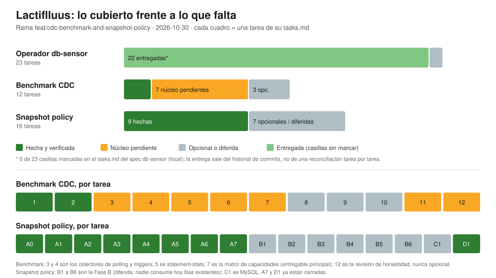

# Reporte de avance: Lactiflluus

Fecha: 2026-10-30 · Rama: `feat/cdc-benchmark-and-snapshot-policy` (9 commits sobre `origin/main`, 39 archivos, +2491 / -32)

## Resumen

Hay tres flujos de trabajo. El operador base está entregado. El benchmark CDC lleva 2 de sus 9 tareas de núcleo. La Fase A del snapshot policy está hecha, con su documentación (D1) y su checkpoint (A7). Solo queda la Fase B, diferida.

| Flujo | Tareas | Hechas | Núcleo pendiente | Opcional o diferida |
|---|---|---|---|---|
| Operador `db-sensor` | 23 | 22 entregadas, sin reconciliar* | 0 | 1 (e2e en kind) |
| Benchmark CDC | 12 | 2 | 7 | 3 |
| Snapshot policy | 16 | 9 | 0 | 7 |

\* Las 23 casillas del `tasks.md` del spec de `db-sensor` (local, no versionado) están sin marcar. Que el trabajo se entregó sale del historial de commits y de los archivos de verificación en `.agents/tasks/` (local, no versionado), no de una reconciliación tarea por tarea. Ese archivo de tareas usa una numeración distinta de la de los commits, así que no lo mapeé tarea a tarea.

## Lo cubierto

### Benchmark CDC (2 de 12)
- **Tarea 1:** `bench/` con cluster kind, PostgreSQL 16 con `wal_level=logical`, y un generador de carga determinista (mismo seed, misma secuencia). Verificado: dos corridas desde cero dieron el mismo resultado.
- **Tarea 2:** colector CDC con el Debezium Operator oficial y transporte HTTP. Verificado en el cluster: los conteos coinciden exactos con el workload (252 inserts, 205 updates, 43 deletes) y el lag fue de unos 0.2 s.

### Snapshot policy: Fase A (A0 a A7) y documentación (D1)
- **A0:** `no_data` es el modo no bloqueante en Debezium 3.6.3; `never` lo rechaza.
- **A1 y A2:** los eventos de snapshot (`op=r`) ya no alimentan el lag, los contadores ni el historial.
- **A3:** el `DebeziumServer` de PostgreSQL arranca con `snapshot.mode=no_data`. Los otros motores no cambian.
- **A4:** `spec.snapshot.offsetStore` (`memory` por defecto, `persistent`). Con `persistent` un reinicio ordenado no reentrega eventos.
- **A5:** `status.snapshot` explica la estrategia y el offset store en una línea.
- **A6:** en una tabla de 100.086 filas, `initial` dejó al sensor ciego 57 s; `no_data` vio el primer evento vivo en 6 s.
- **D1:** `README.md` y `README_spanish.md` documentan los campos nuevos, la limitación de DDL en PostgreSQL y el arranque con reinicios; el ROADMAP queda al día; el ejemplo `snapshot.mode=never` del artículo ahora dice `no_data`.

### Cambios al producto fuera del plan original
El camino con Debezium real no funcionaba; solo el demo sintético. Se corrigió: sink HTTP, inyección del Secret, `database.dbname` y `pgoutput`. Se agregaron `spec.transport.http.url` y `spec.database.name`.

## Lo que falta

### Benchmark CDC (10 tareas)
Núcleo (7):
- **3, 4, 5:** colectores de polling (`pg_stat_user_tables`), triggers y statement-stats.
- **6:** checkpoint de colectores.
- **7:** matriz de capacidades y análisis de costo de puesta en marcha. Es el entregable principal y se puede publicar sin las mediciones.
- **11:** cuerpo del reporte, con la sección obligatoria "dónde CDC no gana".
- **12:** revisión final de honestidad. Nunca es opcional.

Opcional (3): **8, 9, 10**, la medición de overhead, de latencia y la corrida del benchmark.

### Snapshot policy (7 tareas, todas diferidas)
- **Núcleo:** ninguna. A7 (checkpoint) se cerró tras confirmar `go vet`, tests, `helm lint` y `make lint`.
- **Diferidas (7):** B1 a B6 (inspector, política y backfill) y C1 (MySQL). Las métricas no necesitan filas existentes, así que esta fase solo se construye si alguien la necesita.

### Operador base
Reconciliar las casillas de `tasks.md`, y la prueba e2e en kind, que sigue sin hacerse.

## Hallazgos de esta sesión

| # | Hallazgo | Estado |
|---|---|---|
| 1 | El deployer no cableaba Debezium real (sink `none`, contraseña sin resolver, sin dbname, `decoderbufs`) | Corregido, verificado |
| 2 | DDL no es observable en PostgreSQL: un `ALTER TABLE` real no generó señal. Ningún enfoque lo ve | Design del benchmark y README corregidos. **La tesis 13.4 sigue sin reescribirse** |
| 3 | Los eventos de snapshot dejaban un sensor nuevo en `Degraded` con ~48 s de lag | Corregido (A1, A2) |
| 4 | `snapshot.mode=never` es inválido en 3.6.3; tu artículo lo usa de ejemplo | Corregido (D1) |
| 5 | Con el offset en memoria, un reinicio reentrega eventos (y reinicia el snapshot con `initial`) | Corregido con `persistent`, solo reinicio ordenado |
| 6 | El Debezium Operator falla en silencio: sin plantilla de PVC no crea el pod, y un `fileName` relativo no escribe nada | Documentado, y el deployer ya lo evita |
| 7 | La copia del CRD en el chart estaba desactualizada (faltaban `thresholds`) | Corregido |
| 8 | El lint de CI fallaba desde el commit `d38979c` | Corregido (`f05098f`). **Falta ver el CI en verde** |
| 9 | Yo había dicho que el "2.x" del artículo para read-only en Postgres era erróneo. **Me equivoqué**: las notas de release que cité son sobre réplicas, que el artículo distingue. La doc actual del conector lista la opción de solo lectura sin decir desde cuándo | Retractado; el artículo no se tocó en ese punto |
| 10 | Una tabla sin escrituras pasa a `Degraded` a los 30 s (el lag es `ahora − último evento`) | **Decisión abierta** |

## Qué se verificó y qué no

Verificado en un cluster real (kind, Debezium 3.6.3, PostgreSQL 16): los conteos del colector, los modos de snapshot, la persistencia del offset, la ventana ciega y el bloque `status.snapshot`.

Solo con pruebas unitarias o envtest: la clasificación de eventos, el descarte en el pipeline y los mapeos del deployer. `go vet`, los tests y `make lint` pasan en local.

No cubierto:
- Tablas de más de 100.000 filas, y motores distintos de PostgreSQL.
- Reinicio brusco (kill u OOM) con offset persistente.
- Otras versiones de Debezium. Por eso el piso de versión sigue abierto.
- El transporte Kafka.
- Las pruebas e2e y el resultado del CI en GitHub.
- La reentrega de un evento tras reiniciar se infiere por conteo, no por la clave de cada fila.

## Decisiones que necesito de ti

1. ~~**Fase B del snapshot policy**~~ **Decidido: diferida.** Se retoma si una función necesita filas existentes, si se cablea el transporte Kafka, o si un usuario las pide (ver `tasks.md`).
2. **Tabla ociosa:** ¿mostrar "inactivo sin escrituras" como estado propio, o medir el lag con la posición del slot de replicación?
3. **Offset del benchmark:** ¿las corridas usan `memory` o `persistent`? Cambia el costo del enfoque CDC y hay que declararlo.
4. **Tesis del benchmark:** como DDL ya no diferencia a CDC en PostgreSQL, ¿reescribimos el punto 13.4 antes de la tarea 12?
5. **Siguiente paso:** D1 está hecha; ¿seguimos con la tarea 3 del benchmark (polling)?
6. **Integración:** ¿abrimos un PR de la rama a `main`? La `main` local tiene 4 commits que no están en `origin/main`; son los mismos de la rama.
