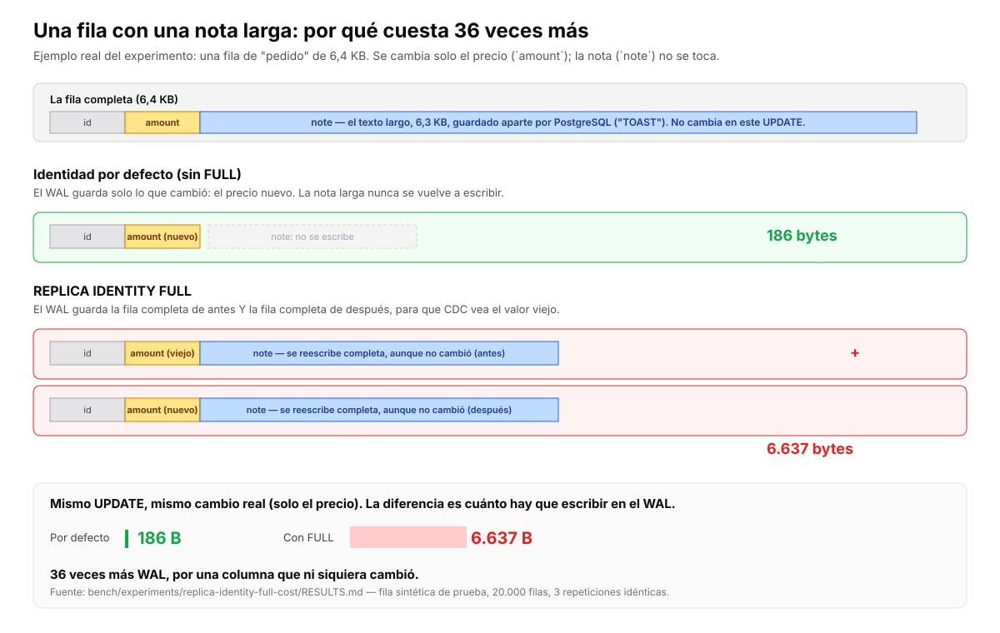

# Estado del proyecto

**Fecha de este resumen: 11 de noviembre de 2026** (actualizado el mismo día con el resultado de los postmortems públicos).

Este documento se actualiza a mano cada vez que algo cambia de estado. No reemplaza `bench/experiments/FINDINGS.md` (los hallazgos técnicos consolidados) ni los `RESULTS.md` de cada experimento (el detalle de cada prueba); es el resumen para explicarle el proyecto a cualquiera, técnico o no, sin tener que leer todo lo demás.

## La pregunta que estamos investigando

Para cada clase de incidente de datos (un job que borra filas por error, una migración que corrompe un valor, un reintento que duplica registros), **¿cuánto mejora reaccionar con CDC + Kubernetes, frente a lo que ya existe hoy sin construir nada nuevo?**

**¿Qué es CDC?** Change Data Capture: una técnica que lee el registro interno de cambios de la base de datos (en PostgreSQL se llama WAL, el "write-ahead log") y convierte cada cambio en un evento: qué fila cambió, cuál era su valor antes, cuál es su valor después, y en qué momento exacto. Es la pieza central de este proyecto (usamos Debezium para hacerlo).

### ¿Frente a qué lo comparamos, y por qué justo esas cuatro cosas?

Elegimos estas cuatro porque son las defensas que cualquier equipo con una base de datos en Kubernetes ya tiene disponibles hoy, sin instalar nada nuevo. Si CDC no les gana a estas cuatro, no se justifica el costo y la complejidad de agregar una pieza más al sistema.

1. **Constraints** (restricciones de la base de datos): reglas que la propia base impone y que ninguna fila puede violar. Por ejemplo, "la columna `status` no puede ser nula" o "el monto no puede ser negativo". Las evalúa la base en el instante en que se intenta escribir, y rechaza la escritura si no cumple.
2. **Triggers** (disparadores): código que la base ejecuta automáticamente cuando algo cambia (antes o después de un INSERT, UPDATE o DELETE). Por ejemplo, un trigger que impide que un pago pase de "liquidado" a "pendiente".
3. **Contadores**: las métricas que la base ya expone sola (cuántas filas cambiaron, cuántas conexiones hay, qué tan rápido crece una tabla). Es lo que la mayoría de los paneles de monitoreo (dashboards) usan hoy.
4. **Restaurar desde un respaldo** (también llamado PITR, de *Point-In-Time Recovery*, "recuperación a un punto en el tiempo"): cuando algo salió mal, se restaura una copia de seguridad tomada antes del incidente y se recupera el estado de la base hasta justo antes de que ocurriera el problema.

No comparamos contra, por ejemplo, herramientas de observabilidad de red o soluciones comerciales de terceros, porque esas no son gratis ni están ya instaladas: agregan su propio costo y su propia complejidad, así que no son el punto de partida "sin construir nada nuevo" que buscamos superar.

## El criterio de salida: cuándo diríamos "esto no vale la pena"

Este criterio (lo llamamos internamente "R9", por ser la novena línea de nuestro plan de investigación) se escribió **antes** de hacer ningún experimento, precisamente para no engañarnos después moviendo la meta según nos convenga.

**La regla, en palabras simples:** si no logramos nombrar más de un caso real (no inventado, no de laboratorio) donde CDC + una reacción automática en Kubernetes le gane claramente a prevenir el problema desde la base de datos (constraints/triggers) y a las alertas por contadores, dejamos de insistir en esta dirección.

**¿Qué significa "le gane claramente"?** No basta con que CDC también detecte el problema. Tiene que hacer algo que las otras dos opciones no puedan hacer, o hacerlo de forma sustancialmente mejor (por ejemplo: ver el contenido exacto de un cambio cuando un contador solo ve "algo cambió"; o reparar con precisión en vez de perder trabajo bueno al restaurar un respaldo completo). Si CDC solo iguala lo que ya hacían los contadores, para efectos de este criterio cuenta como que no ganó.

**¿Por qué "constraints y contadores" y no PITR en esta frase puntual?** Porque la pregunta de R9 nació pensando en *prevenir y detectar* (constraints/triggers evitan el problema antes de que ocurra; los contadores avisan que algo pasó). PITR entra más bien como el competidor a la hora de *reparar* después del incidente, y por eso aparece comparado en detalle en la sub-pregunta 4 (ver abajo) en vez de en la frase general del criterio de salida.

**Primer intento real de encontrar ese "caso real": revisamos 16 postmortems públicos (sub-pregunta 1, abajo).** Encontramos 1 caso claro y 1 parcial, ninguno confirmado con una implementación real de CDC. Por una lectura estricta del criterio, **todavía no se cumple**. El detalle completo está en la sub-pregunta 1.

**Estado de este criterio hoy: no se ha cumplido ni se ha refutado.** No tenemos todavía ese caso real ganador. Lo que sí tenemos es evidencia medida en las dos direcciones: una ventaja real de CDC en un escenario (sub-pregunta 4), un costo real que puede ser alto (sub-pregunta 5), y una fragilidad real de la reacción (sub-pregunta 6). Nada de esto cierra la pregunta todavía.

**¿Cómo se consigue ese "caso real"?** No sale de experimentos técnicos como los de abajo, que son de laboratorio. Sale de hablar con personas que de verdad administran bases de datos en producción y preguntarles si alguna vez vivieron este tipo de incidente, y qué hubieran querido que pasara automáticamente. Esa parte de la investigación (conversaciones con usuarios reales, documentada en `docs/research/user-conversations.md`) todavía no se ha hecho a fondo, y es la que de verdad puede cerrar esta pregunta en cualquier dirección.

## Las 7 sub-preguntas

Partimos la pregunta central en 7 preguntas más chicas y concretas, cada una con su propio experimento medible. (Nota: en los archivos técnicos del repositorio estas preguntas están numeradas de P0 a P6; en este documento las numeramos de 1 a 7, como contamos las personas, para que sea más fácil de leer. Es solo una diferencia de etiqueta, las preguntas son las mismas.)

### 1. ¿Qué clases de incidente aparecen en reportes públicos de fallas (*postmortems*)?

**¿Qué es un "postmortem"?** Es el reporte que una empresa escribe después de una falla grave, explicando qué pasó, por qué, y qué van a cambiar para que no vuelva a pasar. La palabra viene de "autopsia" (examinar después de la muerte) y se usa así en toda la industria del software.

**¿Por qué "públicos"? ¿Existen postmortems privados?** Sí, existen, y de hecho son la mayoría: casi toda empresa escribe estos reportes internamente, pero casi nunca los publica, porque pueden exponer debilidades de seguridad o errores vergonzosos frente a clientes. Nosotros solo podemos leer los que alguien decidió hacer públicos (empresas como GitLab, Cloudflare o muchas otras publican los suyos). Es una limitación real de este método: lo que encontremos ahí es una muestra sesgada, no el panorama completo de lo que pasa en la industria. Para ver el panorama completo haría falta acceso a postmortems privados, que no tenemos, o preguntarle directamente a la gente (que es justo lo que busca la sub-pregunta de las conversaciones con usuarios, mencionada arriba).

**Lo que hicimos:** leímos y catalogamos 16 postmortems públicos reales de incidentes de datos (no caídas de servicio sin problema de datos): 14 publicados directamente por la empresa (GitLab, Atlassian, GitHub, Twilio, Bungie, Travis CI, Razorpay, Turso, OpenAI, Matrix.org, Keepthescore, Kickstarter), y 2 conocidos solo por cobertura de prensa, marcados como menos confiables (Azure DevOps, Salesforce/Pardot). El detalle completo, con la fuente de cada uno, está en `docs/research/p0-public-postmortems.md`.

**El resultado, dicho sin adornos: de 16 incidentes reales, solo 1 es un caso claro donde CDC le gana a la prevención y a los contadores, y 1 más es un caso a medias.**

- **El caso claro: Bungie, el juego Destiny 2, en 2020** (imagen de referencia cultural en `docs/research/p0-public-postmortems.md`). Un error de programación calculó mal la cantidad de un ítem (moneda y materiales del juego) en un subconjunto de servidores, y a los jugadores se les borró parte de su inventario. No había ningún constraint que pudiera detectar esto, porque el valor escrito era un número válido, simplemente estaba mal calculado; y ningún contador lo nota, porque para el contador fue una escritura normal. Lo más revelador: para repararlo, Bungie restauró **las cuentas de todos los jugadores** a un respaldo de antes del error, en vez de intentar identificar cuáles cuentas sí estaban afectadas, porque el riesgo de dejar alguna sin corregir les pareció peor. Es exactamente el costo que medimos nosotros mismos en la sub-pregunta 4: restaurar un respaldo completo descarta trabajo bueno que no tenía nada que ver con el problema.
- **El caso a medias: Matrix.org (el proyecto detrás de la app de mensajería Element), en 2025.** Aquí un constraint, agregado por el equipo justo después de encontrar el problema, sí logró detener el daño en cuanto se reactivó el proceso que lo causaba. En eso, el constraint le ganó a cualquier cosa que CDC hubiera podido hacer. Pero para repararlo, el equipo tuvo que comparar a mano un respaldo viejo contra la base en producción, durante cerca de una semana, para reconstruir la lista exacta de filas afectadas. Un registro de cambios con el valor anterior de cada fila borrada les hubiera dado esa lista de inmediato.
- **Los dos casos ya se corrieron como escenarios de laboratorio** (aproximaciones de la forma del incidente, no reproducciones). Forma Bungie: `bench/experiments/repair-subset-writer/RESULTS.md` (H1 a H4 y H6 se cumplieron, H5 falló en el orden de velocidad; 4 corridas). Forma Matrix: `bench/experiments/repair-via-logical-decoding/RESULTS.md` (`REPLICA IDENTITY FULL`: PASS; identidad por defecto: PASS solo para identificar qué filas; H3 y H4 fallaron en una cláusula; 4 corridas). Cada archivo tiene su sección "Not covered, and not claimed"; el alcance exacto está en sus tablas de veredictos.
- **Los otros 14 casos:** o ya los resuelve algo que no es CDC (permisos revocados, borrado lógico en vez de físico, aislar el ambiente de pruebas del de producción, el propio registro interno de la base de datos que ya existía), o no los resuelve nada de esto (por ejemplo, alguien borró físicamente los archivos del disco con un comando, y ahí no hay ningún "cambio de fila" que CDC pueda ver).

**Una advertencia importante sobre qué tipo de evidencia es esta, antes de seguir.** Un postmortem no es un log, ni una auditoría externa: es un documento que la propia empresa escribió y decidió publicar. No mentimos cuando decimos que "no mienten" en general (los postmortems técnicos como los de GitLab o GitHub suelen tener detalles tan específicos y verificables, como comandos exactos y minuto a minuto, que sería fácil desmentirlos si fueran falsos). Pero eso es muy distinto de que nos estén contando todo. Hay varios filtros antes de que un incidente llegue a ser un postmortem público:

1. **Deciden si publicarlo o no.** La gran mayoría de los incidentes de datos de cualquier empresa nunca se vuelven públicos. Solo vemos los que ya eran imposibles de ocultar (fueron visibles para los usuarios) o los que la empresa elige mostrar como ejercicio de transparencia.
2. **Deciden qué contar dentro del incidente que sí publican.** Van a explicar bien la causa técnica, porque eso los hace ver competentes. Es mucho menos común que incluyan el contexto incómodo que no es parte de la historia puntual (por ejemplo, si el mismo tipo de error ya había pasado antes, o si el equipo de guardia tardó en responder).
3. **No vemos los logs crudos, ni el tráfico real, ni las conversaciones internas del equipo.** Solo vemos el resumen que ellos narraron.

La consecuencia práctica para esta investigación no es tanto "nos pueden estar mintiendo sobre este incidente puntual", sino algo más importante: **qué tipo de incidentes llegamos a ver, y qué tan completos son los detalles que nos cuentan.** Por eso en la lista de 16 no hay, por ejemplo, ningún caso donde la empresa diga "y además nuestro sistema de monitoreo ya tenía fallas conocidas sin resolver": ese tipo de autocrítica casi nunca se publica. Esta es una limitación real del método, no un detalle menor, y es la razón de más peso (junto con que no existe una implementación real de CDC detrás de ninguno de los dos casos) para no tratar este resultado como una prueba cerrada.

**El dato más incómodo, y el más honesto de todo este ejercicio, con esa salvedad ya puesta sobre la mesa: en 0 de los 16 casos una alerta basada en el contenido de un cambio fue lo que detectó el problema.** Esto no prueba que una alerta así no funcionaría (puede ser que ninguna de esas empresas tuviera algo parecido instalado), pero sí confirma que, en la práctica real que pudimos observar, nadie estaba vigilando *qué* cambió; solo se dieron cuenta cuando *algo ya se había roto* (una persona lo reportó, o se disparó una alarma por otra razón).

**¿Qué significa esto para el criterio de salida (R9, explicado arriba)?** Con una lectura estricta, **todavía no se cumple**: el criterio pide más de un caso real y claro, y aquí solo hay uno claro y uno a medias, ninguno de los dos con una implementación real de CDC detrás (son nuestra propia evaluación de qué hubiera pasado si la hubiera habido). Con una lectura generosa, apenas se cumpliría. Por honestidad, no vamos a usar los otros 14 casos (ni siquiera los más dramáticos, como el de GitLab o el de Twilio) como argumento a favor del proyecto en ninguna presentación: son incidentes de datos reales y graves, pero CDC no los hubiera resuelto, y cualquier persona informada que los conozca lo notaría.

**Lo que sí encontramos de valor, aunque no cierre la pregunta:** identificamos la condición exacta bajo la cual CDC gana. Tienen que cumplirse las dos cosas a la vez: (1) el valor incorrecto se ve válido, así que ningún constraint lo detecta, **y** (2) el daño afecta solo una parte de los datos, mientras sigan llegando escrituras buenas de otras partes del sistema. Esa es la misma condición que ya habíamos medido nosotros mismos en el banco de pruebas (sub-pregunta 4, el experimento contra PITR). En esta muestra de 16 postmortems públicos, esa condición solo apareció dos veces.

**Estado: hecho.** Encontramos 1 caso claro y 1 parcial, ninguno con una implementación real de CDC que lo confirme; es evidencia razonada, no probada. El siguiente paso natural es llevar la pregunta que los postmortems públicos no pueden responder a las conversaciones con usuarios reales (la sub-pregunta mencionada en el criterio de salida, arriba): "la última vez que tuviste un cambio malo de datos, ¿fue a toda la tabla o solo a una parte, y seguían llegando escrituras buenas mientras lo arreglabas?".

### 2. ¿Qué tipo de incidente puede ver cada fuente de información?

La idea es simple: cuando algo sale mal en una base de datos, distintas herramientas "ven" cosas distintas. Un contador ve que hubo cambios, pero no qué cambió. Un trigger ve el cambio en el instante, pero se puede evadir. CDC ve el contenido exacto, pero también se puede engañar o evadir de formas específicas. Esta sub-pregunta mapea, fuente por fuente, qué puede detectar y qué se le escapa.

**Lo que ya probamos:**

- **Un trigger se puede evadir.** PostgreSQL permite que una sesión le diga a la base "ignora los triggers por esta vez" con el comando `SET session_replication_role = replica`. Si alguien (una persona, un script, un job) hace eso antes de escribir, el trigger simplemente no se dispara, como si no existiera. Lo confirmamos con una prueba directa: 11 de 11 intentos lo lograron.
- **CDC no se deja engañar por ese truco.** Aunque el trigger no se dispare, CDC de todas formas ve el cambio en la base, porque lee directamente del registro de escritura (el WAL), no depende de que el trigger avise nada.
- **Probamos detectar ese "truco" con una sonda.** ¿**Qué es una sonda en este contexto?** Es un programa pequeño que se instala en la máquina (el nodo) donde corre el cliente que se conecta a la base de datos, y observa el tráfico de red que sale de ahí, sin modificar nada ni bloquear nada, solo mirando. La tecnología que usamos para esto se llama eBPF (una forma de ejecutar código de observación dentro del sistema operativo Linux, de forma segura y eficiente). Construimos una sonda que mira el tráfico hacia la base de datos y trata de detectar cuándo alguien manda ese comando de "ignora los triggers". Resultado: la detectó en 7 de 11 formas distintas de escribir el mismo comando (por ejemplo, escrito con mayúsculas distintas, o metido dentro de una función). Las 4 formas que se le escaparon incluyen, por ejemplo, un cliente que construye el texto del comando en el momento (en vez de escribirlo tal cual) o que usa una conexión cifrada (TLS), donde la sonda ya no puede leer el contenido porque está encriptado.
- **Un hallazgo colateral importante de seguridad:** esa misma sonda, sin querer buscarlo, también puede leer el proceso de inicio de sesión (login) completo: ve el nombre de usuario en texto claro, y ve la estructura del intercambio de autenticación (el protocolo se llama SCRAM). Lo que nunca pudo ver, en ninguna prueba, fue la contraseña, porque SCRAM está diseñado justamente para que la contraseña nunca viaje por la red, ni cifrada de forma reversible.
- **Lo que de verdad cierra el hueco del trigger no es ninguna sonda, es un permiso.** Si a la cuenta de base de datos que usa una aplicación se le quita el privilegio para ejecutar ese comando de "ignora los triggers", la base simplemente rechaza el intento. Eso es más efectivo que cualquier forma de detectarlo después.

**La clasificación sistemática: ya se hizo, y el número es más chico de lo que esperaríamos.** Revisamos 4 proyectos reales de código abierto, grandes y con base de datos pública (Mastodon, Discourse, Saleor y Odoo, los cuatro sobre PostgreSQL), y catalogamos 56 reglas de negocio reales, cada una señalada con el archivo y la línea exacta de donde salió. El detalle completo está en `docs/research/p1-invariant-classification.md`.

**El resultado, dicho sin adornos: de esas 56 reglas, solo 3 (un 5%) son el tipo exacto de regla donde CDC aporta algo que un constraint de la base no podría hacer.**

- **32% (18 de 56)** ya están resueltas por la base de datos misma (un `CHECK`, una llave única, una llave foránea o un trigger). Ahí CDC no agrega nada: la base ya lo cubre.
- **De las que quedan sin cubrir por la base (68%, 38 reglas):**
  - **61% necesita mirar más de una fila a la vez** (sumar varias filas, comparar contra otra tabla, revisar el historial). Esto no lo puede hacer una regla que solo mira el antes y el después de una fila sola; necesitaría un componente con memoria propia, que es un producto distinto y más grande del que estamos pensando construir.
  - **32% sí se puede decidir mirando solo una fila.** Pero de esas, **9 de cada 12 son simplemente algo que un `CHECK` normal de la base ya podría hacer** (por ejemplo "esta cantidad no puede ser negativa"). Solo 3 son reglas de verdad especiales, del tipo "no puedes pasar de liquidado a pendiente", que un `CHECK` no puede expresar pero sí un trigger.
  - **8% no se puede detectar de ninguna forma con CDC**, porque depende de quién hizo el cambio, de información que vive fuera de la base, o porque la propia escritura borra la evidencia de que algo estuvo mal antes.

**Un hallazgo curioso que encontramos en el camino:** en Discourse, un desarrollador agregó una restricción `CHECK` para evitar que un contador quedara en negativo, y **la quitó 28 días después**. No sabemos por qué (no estaba explicado en el código que leímos), pero sugiere que a veces prevenir en la base tiene un costo que no vale la pena pagar, y ahí es donde vigilar sin bloquear (que es lo que haría CDC) podría tener sentido. Es una pista para investigar más, no una conclusión.

**Qué significa esto, junto con el resultado de la sub-pregunta 1 (postmortems):** el panorama que se está armando es consistente en los dos lados. La ventaja real de CDC no es amplia ("vemos todo el contenido, por eso somos mejores en general"). Es angosta y específica: reglas de transición de estado, en tablas donde el equipo no quiere o no puede poner un trigger. Cubrir el 61% que necesita mirar varias filas a la vez significaría construir algo distinto y más grande, que además competiría directo contra las alertas por contadores, que es justo lo que el criterio de salida nos exige superar.

**Estado: hecho.** El resultado es específico y medido (56 reglas clasificadas, cada una con su fuente), pero viene con una salvedad honesta: lo clasificó una sola persona, leyendo código, lo cual probablemente subestima cuántas reglas no están protegidas en ningún lado (la clase "no se encontró protección en ninguna parte"), porque una ausencia es más difícil de notar leyendo código que buscando restricciones que ya existen.

### 3. ¿Cuántos cambios "malos" alcanzan a pasar antes de que la reacción automática actúe?

Si algo sale mal y la respuesta automática tarda en reaccionar, durante ese tiempo pueden seguir entrando más cambios malos. Esta pregunta mide ese tiempo.

**Lo que ya probamos:** en una sola medición, el tiempo desde que ocurrió el cambio malo hasta que un Job de Kubernetes fue frenado automáticamente fue de 0,72 segundos.

**Estado: una sola medición.** No es un número confiable todavía porque solo se corrió una vez; falta repetirlo varias veces para saber si es consistente.

### 4. ¿Se puede reparar un daño usando el propio flujo de cambios de CDC, y cómo se compara con restaurar un respaldo (PITR)?

Esta es la pregunta donde ya tenemos la comparación más completa.

**La idea de "reparar desde el flujo":** como CDC guarda el valor de cada fila antes y después de cada cambio, en teoría se podría usar esa información para "deshacer" exactamente los cambios malos, sin tocar los cambios buenos que pasaron al mismo tiempo. Es como tener un historial detallado de ediciones y poder revertir solo las líneas que un usuario específico escribió mal, sin perder lo que otros usuarios escribieron bien mientras tanto.

**Lo que probamos:** simulamos un incidente (un trabajo que hizo cambios incorrectos en miles de filas) mientras otros trabajos seguían escribiendo datos buenos al mismo tiempo. Reparamos usando solo la información de CDC, y el resultado fue exacto: 0 filas distintas de lo esperado, repetido en 3 corridas.

**Pero tiene tres condiciones caras que hay que cumplir primero:**
1. La tabla necesita tener activado `REPLICA IDENTITY FULL` (ver la siguiente sub-pregunta: esto tiene un costo real).
2. Hace falta guardar todos los eventos de CDC en algún lugar durable por un tiempo (un "almacén de eventos"), y el operador que estamos construyendo hoy no guarda ninguno; simplemente los cuenta y los descarta.
3. Alguien tiene que decirnos de antemano cuáles fueron exactamente las transacciones malas que hay que deshacer. No lo averiguamos automáticamente.

**Lo comparamos contra PITR (restaurar un respaldo):** si en vez de reparar desde el flujo se restaura un respaldo completo a un punto antes del incidente, se pierde todo el trabajo bueno que se hizo después de ese punto, porque PITR regresa toda la base a como estaba, sin distinguir cambios buenos de malos. **Reparar desde el flujo sí distingue entre lo bueno y lo malo, y por eso conserva el trabajo bueno que PITR tendría que descartar.** Esa es la ventaja medida de reparar desde el flujo frente a PITR, no al revés.

**Lo que todavía falta:** el competidor más realista no es PITR solo, sino un "híbrido": restaurar el respaldo y después reaplicar manualmente los cambios buenos que se perdieron. Ese híbrido todavía no lo hemos medido, y es el próximo paso de esta sub-pregunta.

**Estado: probado contra PITR en un escenario**, falta el híbrido.

### 5. ¿Cuánto cuesta activar la capacidad de ver el contenido completo de un cambio?

**¿Por qué nos importa esto?** Porque `REPLICA IDENTITY FULL` es la configuración que hace posible todo lo interesante de las sub-preguntas 2 y 4: sin ella, cuando una fila se actualiza o se borra, CDC solo ve el valor *nuevo*, no el valor que tenía *antes*. Sin el valor anterior, no se puede detectar una transición prohibida (por ejemplo "de liquidado a pendiente") ni reparar nada, porque no sabemos a qué había que regresar la fila. Es decir: `REPLICA IDENTITY FULL` no es un detalle técnico menor, es el interruptor que activa o desactiva buena parte del valor que este proyecto promete. Por eso necesitábamos saber qué cuesta encenderlo.

**¿Qué quiere decir "filas sintéticas"?** Que no usamos una base de datos de un proyecto real. Construimos a propósito cuatro tablas de prueba, cada una con un tipo de fila distinto (una fila angosta de unos 80 bytes, una de 1 KB, una de 1,8 KB, y una de 6,4 KB con un campo de texto largo), para poder medir el efecto de forma controlada y repetible. "Sintético" aquí no significa "inventado al azar": significa que diseñamos la forma de la fila a propósito, para aislar la variable que queríamos medir (el ancho de la fila), en vez de depender de los datos de una aplicación real que no controlamos. La contraparte de "sintético" es "de producción": datos reales de un proyecto real, que es justo lo que todavía nos falta conseguir (ver el estado, abajo).

**Lo que probamos:** medimos cuánto más espacio ocupa en el registro de escritura (el WAL) cada operación de actualizar o borrar una fila, con esta opción prendida contra apagada, en esas cuatro filas sintéticas.

**Resultado, y es la sorpresa más clara de todo el trabajo hasta ahora:** el costo no es un número fijo, depende muchísimo de cómo es la fila.

| Tipo de fila | Sin `FULL` (por UPDATE) | Con `FULL` (por UPDATE) | Cuánto más |
|---|---|---|---|
| Angosta (unos 80 bytes, sin texto largo) | 175 bytes | 239 bytes | 1,4 veces |
| Con un campo de 1 KB | 1.159 bytes | 2.195 bytes | 1,9 veces |
| Con un campo de 1,8 KB | 1.972 bytes | 3.802 bytes | 1,9 veces |
| Con un campo de 6,4 KB que no cambió en ese UPDATE | 186 bytes | 6.637 bytes | **36 veces** |

**Un ejemplo concreto, para que quede claro por qué pasa esto:** imagina una fila de un pedido, con un precio (`amount`) y una nota larga (`note`) de unos 6,4 KB, de esas que PostgreSQL guarda en un lugar aparte por ser muy grandes (esa técnica se llama "TOAST", de *The Oversized-Attribute Storage Technique*). Alguien solo actualiza el precio; la nota no se toca para nada.

**Primero, cómo se guarda esa fila en el disco, antes de que nadie la toque.** Esto es clave para entender todo lo demás: PostgreSQL no guarda el texto largo junto con el resto de la fila. Lo mueve a una tabla aparte (la "tabla TOAST") y en el lugar original de la fila deja solo una especie de "ficha" con la dirección de dónde está guardado (lo llamamos aquí "puntero"), de 18 bytes. Verificado en PostgreSQL 16 con una fila real: una nota de 6.400 bytes guardada así deja una fila de solo 53 bytes en la tabla principal (incluye un encabezado interno de unos 23 bytes, el `id`, el `amount`, y el puntero de 18 bytes a la nota). El texto completo vive aparte, partido en pedazos, en la tabla TOAST:

```
Tabla "orders" (donde viven las filas normales)        Tabla TOAST (solo para columnas muy grandes)
┌───────────────────────────────────────┐              ┌──────────┬────────┬───────────────┐
│ id=4711 │ amount=149.99 │ note=[ficha] │  el puntero  │ chunk_id │ nro.   │ un pedazo del │
│                                        │ ───apunta──► │ 16411    │ 0,1,2… │ texto, cada    │
│  53 bytes en total (con el puntero,    │   a:         │          │        │ uno de hasta   │
│  no con el texto)                      │              │          │        │ ~2.000 bytes   │
└───────────────────────────────────────┘              └──────────┴────────┴───────────────┘
```

Dos cosas que este dibujo deja claras y que suelen sorprender a quien no lo ha visto antes:

- **El texto largo casi nunca "vive" junto a la fila.** Lo que hay en la tabla principal es una ficha de 18 bytes con la dirección, no el texto. Por eso una fila con una nota de 6,4 KB puede pesar, en la tabla principal, apenas 53 bytes.
- **Leer la columna completa (`SELECT note FROM orders`) obliga a PostgreSQL a ir a buscar todos los pedazos y pegarlos de nuevo**, para devolverte el texto completo como si nunca se hubiera partido. Eso tiene un costo de lectura que normalmente no se nota, pero que conviene saber que existe: no es gratis "ver" una columna TOAST.

**Ahora sí, qué pasa cuando se actualiza solo el precio, sin tocar la nota:**

- **Sin `FULL`:** el WAL solo guarda el precio nuevo. La ficha de 18 bytes que apunta a la nota no cambia, así que ni se vuelve a escribir. Costo medido en el experimento (con una nota de forma similar): 186 bytes.
- **Con `FULL`:** PostgreSQL tiene que guardar, además, la fila *completa* de antes del cambio y la fila *completa* de después, para que CDC pueda comparar y saber cuál era el valor viejo. El problema es que "la fila completa" para efectos de este registro **incluye el contenido real de la nota, no solo su ficha**. Por eso el costo se dispara: no es que se reescriba un puntero de 18 bytes dos veces, es que se tiene que reescribir el texto completo de la nota, dos veces, aunque no haya cambiado ni una letra de ella. Costo medido: 6.637 bytes.

Es la misma operación, el mismo cambio real (solo el precio), pero 36 veces más trabajo de escritura, solo por tener esa columna ancha al lado y no haber podido reutilizar la ficha.



*(Los números de bytes de la tabla y el ejemplo de arriba son del experimento real, con filas de prueba. El tamaño del puntero TOAST, 18 bytes, y el tamaño de la fila comprimida a 53 bytes sí se verificaron directamente en una PostgreSQL 16 real para este documento; el resto de las cifras de esta sección vienen de `bench/experiments/replica-identity-full-cost/RESULTS.md`.)*

**Estado: medido, pero solo en estas cuatro filas sintéticas.** Falta todavía averiguar cómo son las tablas de un proyecto real (de producción), para saber si el escenario de la columna ancha sin cambiar (el de 36 veces) es raro o común en la práctica.

### 6. ¿Cuánto puede fallar la propia reacción automática?

Esta es la que más puede cambiar el rumbo del proyecto, y es la que acabamos de terminar de investigar a fondo.

**El contexto:** armamos una cadena completa de piezas ya existentes (sin código nuestro) para ver si podían hacer lo que proponemos: Debezium (que lee los cambios de PostgreSQL) envía los eventos a Kafka (un sistema de mensajería), y de ahí a Argo Events (una herramienta que puede reaccionar a eventos ejecutando acciones en Kubernetes, como frenar un Job).

**El problema que encontramos:** si justo en el momento en que llega un evento, el pod de Argo Events que debía procesarlo (llamado "Sensor") está siendo reemplazado por uno nuevo (algo normal y constante en Kubernetes), el evento se podía perder.

**Por qué pasa, explicado desde cero:**

- **¿Qué es un "bus" en este contexto?** Es el sistema intermediario de mensajería que recibe los eventos de un lado y los entrega al otro, parecido a una oficina de correos: los mensajes pasan por ahí antes de llegar a su destino final. En nuestro caso, el bus es un sistema llamado **NATS** (que significa *Neural Autonomic Transport System*, aunque en la práctica el nombre no importa tanto como lo que hace: mover mensajes de forma confiable entre partes de un sistema distribuido). Específicamente usamos una variante suya llamada "NATS Streaming".
- **Lo que descubrimos:** cuando el pod viejo del Sensor muere, a veces no logra avisarle correctamente al bus "ya no estoy, no me mandes más nada". El bus entonces sigue pensando que ese pod muerto está activo, y le sigue entregando mensajes a él, como si fuera un buzón de correo al que alguien sigue mandando cartas aunque la persona ya no vive ahí. El mensaje se queda "atascado" esperando a que ese buzón fantasma lo recoja, cosa que nunca va a pasar.
- **¿Se pierde para siempre?** No necesariamente. El bus tiene su propio mecanismo de salud (llamado "heartbeat" o latido, como el pulso) que cada cierto tiempo revisa si sus miembros siguen vivos. Cuando por fin se da cuenta de que ese pod ya no existe (algo que tardó entre 5 y 6 minutos en nuestras pruebas), libera el mensaje atascado y se lo entrega a un pod que sí está vivo. Entonces el mensaje llega, pero muy tarde.
- **El caso realmente grave:** si durante esos 5 o 6 minutos de atraso llega un mensaje *más nuevo* y ese sí se procesa normalmente, el sistema puede descartar el mensaje viejo cuando por fin se libera, pensando que ya quedó obsoleto. En ese caso el mensaje original, el que reportaba el incidente real, se pierde de verdad, no solo se atrasa. Confirmamos esto en pruebas controladas: pasó en 6 de 6 intentos.
- **¿Se puede arreglar cambiando una configuración?** Probamos varias cosas: acortar el tiempo del "latido" (ayuda a que se note más rápido, pero no evita el descarte del mensaje viejo), y usar un mecanismo distinto de coordinación de Kubernetes (ayudó bastante a que el pod se despida correctamente, pero no cubre todos los casos, como cuando el pod muere de golpe sin aviso, por ejemplo por quedarse sin memoria). Ningún ajuste que probamos cierra el problema del todo en este sistema de mensajería en particular.

**Lo más importante de este hallazgo para el rumbo del proyecto:** esto se probó en una cadena hecha con piezas externas (Argo Events y NATS), no en el mecanismo propio que este proyecto construiría. No sabemos todavía si nuestro propio operador tendría exactamente esta misma falla, porque esa pieza propia nunca se ha construido. Pero ya sabemos, con evidencia real, qué tipo de falla hay que cuidar: un pod que parece estar vivo para el sistema de mensajería pero en realidad ya murió, y un mensaje viejo que puede perderse si uno nuevo lo "adelanta".

**Estado: mecanismo confirmado**, con evidencia medida, no es una suposición.

**Nota de diseño para cuando se construya la pieza propia (entrega garantizada):** revisamos un proyecto externo, `cilium-explain`, que diagnostica fallas de red en Kubernetes. No vamos a usar su código, pero su patrón de diseño nos parece útil: en vez de encadenar condicionales (si pasa A, revisa B, si no, revisa C), ellos corren siempre *todas* las reglas de diagnóstico de forma independiente, cada una produce su propio hallazgo con su propia evidencia, y un componente aparte ("el correlacionador") ordena esos hallazgos en una causa principal y causas secundarias. La ventaja: un hallazgo nunca tapa a otro. Si alguna vez construimos la lógica de "entrega garantizada" que esta sub-pregunta dice que falta, vale la pena diseñarla así desde el principio. Queda anotado en `ROADMAP.md`, en la fila de "Content policies and a Kubernetes reaction".

### 7. ¿Sobre qué trabajo (workload) se está actuando realmente?

Cuando la reacción automática frena o modifica algo en Kubernetes, ¿estamos seguros de que actuamos sobre el trabajo correcto, el que de verdad causó el problema, y no sobre otro que coincide por casualidad en tiempo o en nombre?

**Estado: sin probar.** No se ha hecho ningún experimento sobre esto todavía.

## Qué significa todo esto para hacia dónde va el proyecto

Desde el principio, el proyecto se puso por escrito una condición: *"si la reacción automática puede perder eventos por su propio diseño, hay que construir un mecanismo de entrega garantizada antes de construir ninguna regla sobre el contenido de los datos."*

La sub-pregunta 6 (arriba) le dio a esa condición evidencia real por primera vez, al menos para una cadena de referencia armada con piezas existentes. Ya no es una preocupación teórica: sabemos exactamente qué tipo de falla puede ocurrir y por qué.

Esto no significa que el proyecto esté condenado, ni que esté confirmado. Significa que, si seguimos adelante construyendo nuestro propio mecanismo de reacción, ese mecanismo tiene que estar diseñado desde el principio para resistir este tipo de falla (un "miembro fantasma" que parece vivo), y eso probablemente haya que resolverlo antes de construir cualquier política sobre el contenido de los cambios.

## Lo que sigue, en orden

1. **La "matriz del diente" del heartbeat.** Entender cómo interactúan dos configuraciones del latido de salud (entre 5 y 120 segundos) con la frecuencia de guardado de posición (entre 10 y 60 segundos), para dejar de adivinar por qué el patrón de alertas se ve como un diente de sierra.
2. **Clasificar las reglas de negocio de proyectos reales de código abierto** (sub-preguntas 1 y 2): cuáles caben en un constraint o trigger normal, y cuáles de verdad necesitan ver el contenido con CDC. Esto es lo que termina de cerrar la pregunta central del proyecto.
3. **El híbrido de la sub-pregunta 4:** restaurar un respaldo y después reaplicar encima los cambios buenos que se perdieron, para compararlo de verdad contra reparar desde el flujo.
4. **La fase 2 del heartbeat:** enseñarle al sensor a distinguir una tabla que simplemente no tiene actividad (normal) de un conector que de verdad se quedó atascado (un problema real).

## Dónde está cada cosa, si quieres profundizar

- **Hallazgos técnicos consolidados, con más detalle:** `bench/experiments/FINDINGS.md`
- **El resultado completo de cada experimento, con los números crudos:** `bench/experiments/<nombre-del-experimento>/RESULTS.md`
- **Lista detallada de pendientes y decisiones abiertas:** `docs/HANDOFF.md`
- **La presentación y el guion para explicarle esto al equipo:** `docs/overview/checkup/`
- **El criterio de salida (R9) y el plan de conversaciones con usuarios reales:** `docs/research/user-conversations.md`
- **El detalle completo de los 16 postmortems revisados, con fuentes:** `docs/research/p0-public-postmortems.md`
- **El detalle completo de las 56 reglas de negocio clasificadas, con fuentes:** `docs/research/p1-invariant-classification.md`
